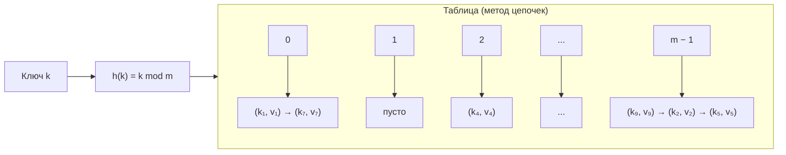
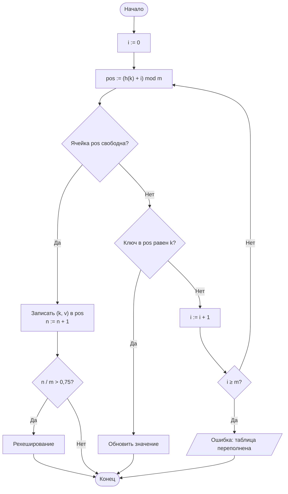

# Лабораторная работа № 5

## Хеширование и экспериментальное исследование методов разрешения коллизий

**Дисциплина:** Теория алгоритмов
**Направление подготовки:** 38.03.05 «Бизнес-информатика»
**Курс:** 2
**Объём:** 4 академических часа
**Язык реализации:** Python 3.10+
**Предварительные требования:** ЛР № 4 (алгоритмы поиска)

---

## 1. Цель и задачи работы

**Цель работы:** изучить принципы хеширования как способа организации данных с временем доступа $O(1)$ в среднем, реализовать хеш-таблицу и экспериментально исследовать влияние хеш-функции и коэффициента заполнения на её производительность.

**Задачи:**

1. Изучить понятия хеш-функции, коллизии, коэффициента заполнения и рехеширования.
2. Реализовать хеш-таблицу двумя способами разрешения коллизий: методом цепочек и открытой адресацией.
3. Измерить время вставки и поиска при различных коэффициентах заполнения.
4. Сравнить качественную и заведомо неудачную хеш-функции по числу коллизий.
5. Сопоставить собственную реализацию со встроенным типом `dict`.

---

## 2. Теоретическая часть

### 2.1. Прямая адресация и её ограничение

Если ключи — целые числа из небольшого диапазона $[0; m)$, доступ к элементу можно организовать за $O(1)$: значение хранится в ячейке массива с индексом, равным ключу. Такой приём называется **прямой адресацией**.

Практические задачи этому условию не удовлетворяют: ИНН, номера договоров, адреса электронной почты образуют множество возможных значений, несоизмеримо большее числа фактически хранимых записей. Хранить массив на $10^{12}$ ячеек ради тысячи клиентов невозможно.

### 2.2. Хеш-функция

**Хеш-функция** $h$ отображает множество ключей $U$ в множество индексов таблицы:

$$h: U \to \{0, 1, \ldots, m - 1\},$$

где $m$ — размер таблицы. Элемент с ключом $k$ хранится в ячейке $h(k)$.

Поскольку $\lvert U \rvert \gg m$, отображение не может быть взаимно однозначным. Ситуация $h(k_1) = h(k_2)$ при $k_1 \ne k_2$ называется **коллизией**.

**Требования к хеш-функции:**

1. быстрое вычисление;
2. равномерное распределение значений по ячейкам;
3. зависимость результата от **всех** разрядов ключа.

**Примеры хеш-функций для целых ключей:**

| Метод | Формула | Замечание |
|---|---|---|
| Деления | $h(k) = k \bmod m$ | $m$ следует брать простым; степени двойки использовать нельзя — учитываются только младшие разряды |
| Умножения | $h(k) = \lfloor m \cdot \{k \cdot A\} \rfloor$, $A \approx 0{,}618$ | $\{x\}$ — дробная часть; размер $m$ произволен |
| Наихудший случай | $h(k) = k \bmod 10$ | Всего 10 различных значений: используется в работе как отрицательный пример |

Для строк применяется полиномиальное хеширование:

$$h(s) = \left(\sum_{i=0}^{L-1} s_i \cdot p^{\,i}\right) \bmod m,$$

где $p$ — простое число (обычно 31 или 131), $s_i$ — код символа.

### 2.3. Метод цепочек

Все элементы с одинаковым значением хеша хранятся в связном списке, присоединённом к соответствующей ячейке.

Пусть $n$ — число хранимых элементов, $m$ — число ячеек. Величина

$$\alpha = \frac{n}{m}$$

называется **коэффициентом заполнения** и равна средней длине цепочки. Средняя трудоёмкость поиска составляет $\Theta(1 + \alpha)$, то есть $\Theta(1)$ при $\alpha = O(1)$. В худшем случае (все ключи попали в одну ячейку) трудоёмкость равна $\Theta(n)$.

Метод цепочек допускает $\alpha > 1$.

### 2.4. Открытая адресация

Все элементы хранятся непосредственно в массиве, дополнительных списков нет. При занятости ячейки проверяется следующая по заданному правилу:

| Способ пробирования | Формула | Свойство |
|---|---|---|
| Линейное | $h_i(k) = (h(k) + i) \bmod m$ | Просто; вызывает **первичную кластеризацию** — образование длинных занятых участков |
| Квадратичное | $h_i(k) = (h(k) + c_1 i + c_2 i^2) \bmod m$ | Кластеризация слабее |
| Двойное хеширование | $h_i(k) = (h_1(k) + i \cdot h_2(k)) \bmod m$ | Наилучшее распределение проб |

При открытой адресации обязательно $\alpha < 1$. Теоретическая оценка среднего числа проб при неуспешном поиске и равномерном хешировании:

$$C_{\text{ср}} \approx \frac{1}{1 - \alpha}.$$

Отсюда следует, что при $\alpha = 0{,}5$ требуется около 2 проб, при $\alpha = 0{,}9$ — около 10, а при $\alpha \to 1$ трудоёмкость неограниченно возрастает. Это главная причина, по которой таблицу расширяют, не дожидаясь её полного заполнения.

**Удаление элементов** при открытой адресации нельзя выполнять простым обнулением ячейки: это разорвало бы последовательность проб. Используется специальная пометка «удалено» (tombstone).

### 2.5. Рехеширование

При превышении порогового значения $\alpha$ (обычно 0,75) создаётся таблица большего размера, и все элементы вставляются в неё заново. Операция стоит $\Theta(n)$, однако выполняется редко, поэтому **амортизированная** стоимость вставки остаётся $O(1)$.

### 2.6. Сравнение с другими структурами

| Структура | Поиск | Вставка | Упорядоченность | Худший случай поиска |
|---|---|---|---|---|
| Неупорядоченный массив | $\Theta(n)$ | $\Theta(1)$ | Нет | $\Theta(n)$ |
| Упорядоченный массив | $\Theta(\log n)$ | $\Theta(n)$ | Да | $\Theta(\log n)$ |
| Хеш-таблица | $\Theta(1)$ в среднем | $\Theta(1)$ в среднем | **Нет** | $\Theta(n)$ |

Отсутствие упорядоченности — существенное ограничение: хеш-таблица не позволяет эффективно выполнять запросы вида «все договоры на сумму от 100 000 до 500 000» и не поддерживает вывод данных по возрастанию ключа.

---

## 3. Порядок выполнения работы

1. Изучить теоретическую часть.
2. Реализовать класс хеш-таблицы с методами `insert`, `search`, `delete`, подсчитывающими число проб (сравнений).
3. Реализовать оба способа разрешения коллизий согласно варианту (табл. 1).
4. Заполнить таблицу $n$ ключами и измерить: среднее число проб при поиске, время вставки и поиска, распределение длин цепочек (или кластеров).
5. Построить график зависимости среднего числа проб от коэффициента заполнения $\alpha$ и сопоставить его с теоретической кривой $\frac{1}{1 - \alpha}$.
6. Сравнить качественную и неудачную хеш-функции.
7. Сопоставить собственную реализацию со встроенным `dict`.
8. Выполнить дополнительное задание и оформить отчёт.

---

## 4. Варианты заданий

**Обозначения в табл. 1:**

- **Хеш:** Д — метод деления ($m$ простое), У — метод умножения, П — полиномиальный для строк;
- **Коллизии:** Ц — метод цепочек, Л — линейное пробирование, К — квадратичное пробирование, Дв — двойное хеширование.

**Таблица 1. Исходные данные**

| № | Тип ключей | Хеш | Коллизии | $n$ элементов | Размер $m$ | Доп. |
|---|---|---|---|---|---|---|
| 0 | Целые случайные | Д | Ц и Л | 50 000 | 65 521 | — |
| 1 | Целые случайные | У | Ц и Л | 20 000 | 32 768 | В1 |
| 2 | Целые последовательные | Д | Ц и К | 50 000 | 65 521 | В2 |
| 3 | Строки (имена) | П | Ц и Л | 30 000 | 49 999 | В3 |
| 4 | Целые случайные | Д | Л и К | 40 000 | 65 521 | В4 |
| 5 | Целые кратные 10 | Д | Ц и Л | 25 000 | 32 771 | В5 |
| 6 | Строки (артикулы) | П | Ц и Дв | 30 000 | 49 999 | В6 |
| 7 | Целые случайные | У | Л и Дв | 50 000 | 65 536 | В7 |
| 8 | Целые случайные | Д | Ц и Л | 100 000 | 131 071 | В1 |
| 9 | Строки (e-mail) | П | Ц и К | 20 000 | 32 771 | В2 |
| 10 | Целые последовательные | У | Ц и Л | 60 000 | 99 991 | В3 |
| 11 | Целые случайные | Д | К и Дв | 40 000 | 65 521 | В4 |
| 12 | Строки (ИНН) | П | Ц и Л | 50 000 | 65 521 | В5 |
| 13 | Целые кратные 100 | Д | Ц и Дв | 30 000 | 49 999 | В6 |
| 14 | Целые случайные | У | Ц и К | 25 000 | 32 768 | В7 |
| 15 | Строки (названия фирм) | П | Л и К | 20 000 | 32 771 | В1 |
| 16 | Целые случайные | Д | Ц и Л | 80 000 | 99 991 | В2 |
| 17 | Целые последовательные | Д | Л и Дв | 50 000 | 65 521 | В3 |
| 18 | Строки (номера договоров) | П | Ц и Л | 40 000 | 65 521 | В4 |
| 19 | Целые случайные | У | Ц и Дв | 60 000 | 99 991 | В5 |
| 20 | Целые кратные 16 | Д | Ц и Л | 30 000 | 32 768 | В6 |
| 21 | Строки (адреса) | П | К и Дв | 25 000 | 49 999 | В7 |
| 22 | Целые случайные | Д | Ц и К | 70 000 | 99 991 | В1 |
| 23 | Целые случайные | У | Ц и Л | 35 000 | 65 536 | В2 |
| 24 | Строки (имена) | П | Ц и Дв | 45 000 | 65 521 | В3 |
| 25 | Целые последовательные | Д | Ц и К | 40 000 | 49 999 | В4 |
| 26 | Целые случайные | Д | Л и К | 55 000 | 65 521 | В5 |
| 27 | Строки (артикулы) | П | Ц и Л | 35 000 | 49 999 | В6 |
| 28 | Целые кратные 1000 | У | Ц и Дв | 20 000 | 32 771 | В7 |
| 29 | Целые случайные | Д | Ц и Л | 90 000 | 131 071 | В1 |
| 30 | Целые и строки | Д, П | Ц и Л | 50 000 | 65 521 | В4 |

**Таблица 2. Дополнительные задания**

| Код | Содержание |
|---|---|
| В1 | Реализовать **рехеширование** при $\alpha > 0{,}75$ с удвоением размера. Построить график времени вставки от номера операции и объяснить всплески |
| В2 | Сравнить качественную хеш-функцию с заведомо неудачной $h(k) = k \bmod 10$. Привести гистограмму заполнения ячеек и среднее число проб |
| В3 | Реализовать **удаление** элементов (с пометкой «удалено» при открытой адресации). Показать, что простое обнуление ячейки нарушает поиск |
| В4 | Построить экспериментальную зависимость числа проб от $\alpha \in \{0{,}1;\ 0{,}3;\ 0{,}5;\ 0{,}7;\ 0{,}9;\ 0{,}95\}$ и наложить теоретическую кривую $\frac{1}{1-\alpha}$ |
| В5 | Сравнить время работы собственной таблицы со встроенным `dict` на тех же данных. Объяснить разницу |
| В6 | Исследовать **кластеризацию** при линейном пробировании: построить распределение длин непрерывных занятых участков при разных $\alpha$ |
| В7 | Решить прикладную задачу: подсчитать частоты элементов в логе из $10^6$ записей (число уникальных клиентов, топ-10 по числу операций) и сравнить время с решением через список и `in` |

---

## 5. Требования к отчёту

1. Титульный лист.
2. Цель работы и задание варианта.
3. Описание выбранной хеш-функции и способов разрешения коллизий.
4. Схема структуры данных (цепочки или массив с пробами).
5. Листинг программы.
6. Таблицы измерений и графики.
7. Результат выполнения дополнительного задания.
8. Выводы.

---

## 6. Пример оформления отчёта (вариант 0)

### 6.1. Задание

Реализовать хеш-таблицу с методом деления ($m = 65\,521$ — простое число) и двумя способами разрешения коллизий: цепочками и линейным пробированием. Вставить 50 000 случайных целых ключей, измерить время вставки и поиска, среднее число проб, длины цепочек. Сравнить с `dict`.

### 6.2. Схема структуры данных



### 6.3. Блок-схема вставки при линейном пробировании



### 6.4. Листинг программы

```python
"""
Лабораторная работа № 5. Вариант 0.
Хеш-таблица: метод цепочек и линейное пробирование.
"""
import random
import time

M = 65_521          # размер таблицы (простое число)


class ChainHashTable:
    """Хеш-таблица с разрешением коллизий методом цепочек."""

    def __init__(self, m=M):
        self.m = m
        self.slots = [[] for _ in range(m)]
        self.n = 0
        self.probes = 0          # счётчик просмотренных элементов

    def _hash(self, key):
        return key % self.m

    def insert(self, key, value):
        chain = self.slots[self._hash(key)]
        for i, (k, _) in enumerate(chain):
            self.probes += 1
            if k == key:
                chain[i] = (key, value)
                return
        chain.append((key, value))
        self.n += 1

    def search(self, key):
        for k, v in self.slots[self._hash(key)]:
            self.probes += 1
            if k == key:
                return v
        return None

    def chain_lengths(self):
        return [len(c) for c in self.slots]


class OpenHashTable:
    """Хеш-таблица с открытой адресацией (линейное пробирование)."""

    EMPTY = object()
    DELETED = object()

    def __init__(self, m=M):
        self.m = m
        self.keys = [self.EMPTY] * m
        self.values = [None] * m
        self.n = 0
        self.probes = 0

    def _hash(self, key):
        return key % self.m

    def insert(self, key, value):
        pos = self._hash(key)
        for _ in range(self.m):
            self.probes += 1
            k = self.keys[pos]
            if k is self.EMPTY or k is self.DELETED:
                self.keys[pos], self.values[pos] = key, value
                self.n += 1
                return
            if k == key:
                self.values[pos] = value
                return
            pos = (pos + 1) % self.m
        raise RuntimeError("Таблица переполнена")

    def search(self, key):
        pos = self._hash(key)
        for _ in range(self.m):
            self.probes += 1
            k = self.keys[pos]
            if k is self.EMPTY:
                return None
            if k != self.DELETED and k == key:
                return self.values[pos]
            pos = (pos + 1) % self.m
        return None

    def cluster_lengths(self):
        """Длины непрерывных занятых участков."""
        occupied = [k is not self.EMPTY for k in self.keys]
        lengths, current = [], 0
        for flag in occupied + [False]:
            if flag:
                current += 1
            elif current:
                lengths.append(current)
                current = 0
        return lengths


def benchmark(table, keys, queries):
    """Возвращает время вставки, время поиска и среднее число проб при поиске."""
    t0 = time.perf_counter()
    for k in keys:
        table.insert(k, k)
    t_insert = time.perf_counter() - t0

    table.probes = 0
    t0 = time.perf_counter()
    for q in queries:
        table.search(q)
    t_search = time.perf_counter() - t0
    return t_insert, t_search, table.probes / len(queries)


if __name__ == "__main__":
    N = 50_000
    rng = random.Random(42)
    keys = rng.sample(range(10_000_000), N)
    queries = [rng.choice(keys) for _ in range(10_000)]

    print(f"n = {N}, m = {M}, α = {N / M:.3f}\n")
    for name, table in [("Цепочки", ChainHashTable()),
                        ("Линейное пробирование", OpenHashTable())]:
        ti, ts, probes = benchmark(table, keys, queries)
        print(f"{name:<24} вставка {ti:.3f} с, поиск {ts:.3f} с, "
              f"проб на запрос {probes:.2f}")

    # эталон — встроенный словарь
    t0 = time.perf_counter()
    d = {k: k for k in keys}
    ti = time.perf_counter() - t0
    t0 = time.perf_counter()
    for q in queries:
        d.get(q)
    ts = time.perf_counter() - t0
    print(f"{'dict (эталон)':<24} вставка {ti:.3f} с, поиск {ts:.3f} с")

    ch = ChainHashTable()
    for k in keys:
        ch.insert(k, k)
    lengths = ch.chain_lengths()
    print(f"\nДлины цепочек: макс. {max(lengths)}, "
          f"пустых ячеек {lengths.count(0)} из {M}")
```

### 6.5. Результаты

Измерения выполнены в среде Linux, Python 3.12. Вставлено 50 000 ключей, выполнено 10 000 успешных запросов.

**Таблица 3. Результаты при $n = 50\,000$, $m = 65\,521$, $\alpha = 0{,}763$**

| Реализация | Время вставки, с | Время поиска, с | Проб на запрос |
|---|---|---|---|
| Метод цепочек | 0,030 | 0,003 | 1,38 |
| Линейное пробирование | 0,021 | 0,005 | 2,68 |
| Встроенный `dict` (эталон) | 0,015 | 0,001 | — |

**Таблица 4. Распределение по ячейкам (метод цепочек)**

| Показатель | Значение |
|---|---|
| Средняя длина цепочки ($\alpha$) | 0,76 |
| Максимальная длина цепочки | 7 |
| Пустых ячеек | 30 423 из 65 521 (46 %) |

Теоретическая оценка числа проб при линейном пробировании для успешного поиска составляет $\frac{1}{2}\left(1 + \frac{1}{1 - \alpha}\right) \approx 2{,}6$ при $\alpha = 0{,}76$, что близко к измеренному значению 2,68.

### 6.6. Выводы (образец)

1. При коэффициенте заполнения $\alpha \approx 0{,}76$ обе реализации обеспечивают поиск за малое число проб, что соответствует теоретической оценке $\Theta(1 + \alpha)$ для цепочек.
2. Метод цепочек устойчивее к росту $\alpha$: среднее число проб растёт линейно по $\alpha$, тогда как при линейном пробировании оно растёт как $\frac{1}{1 - \alpha}$ и резко увеличивается вблизи полного заполнения.
3. Распределение длин цепочек близко к пуассоновскому: значительная доля ячеек пуста, а максимальная длина цепочки существенно превышает среднюю. Это иллюстрирует различие между средним и худшим случаями.
4. Встроенный `dict` быстрее собственной реализации, поскольку написан на C и использует оптимизированные схемы пробирования. Собственная реализация имеет учебное назначение и позволяет наблюдать внутренние характеристики, недоступные через стандартный интерфейс.
5. Для прикладных задач подсчёта уникальных значений и частот хеш-таблица даёт принципиальный выигрыш перед списком: $O(n)$ против $O(n^2)$.

---

## 7. Контрольные вопросы

1. Почему прямая адресация неприменима к таким ключам, как ИНН или номер договора?
2. Дайте определение коллизии. Почему коллизии неизбежны?
3. Перечислите требования к хеш-функции. Почему $h(k) = k \bmod 10$ плоха?
4. Почему в методе деления размер таблицы рекомендуется брать простым числом?
5. Что такое коэффициент заполнения? Какие значения он может принимать при цепочках и при открытой адресации?
6. Объясните формулу $C_{\text{ср}} \approx \frac{1}{1 - \alpha}$. Что происходит при $\alpha \to 1$?
7. Что такое первичная кластеризация и как с ней борются?
8. Почему при открытой адресации нельзя просто обнулять ячейку при удалении?
9. Что такое рехеширование? Почему вставка остаётся $O(1)$ амортизированно?
10. Какие запросы к данным хеш-таблица выполнять не умеет? Какую структуру следует выбрать в этом случае?

---

## 8. Рекомендуемая литература

1. Кормен Т., Лейзерсон Ч., Ривест Р., Штайн К. Алгоритмы: построение и анализ. — 3-е изд. — М.: Вильямс, 2013. — Гл. 11.
2. Кнут Д. Э. Искусство программирования. Т. 3. Сортировка и поиск. — 2-е изд. — М.: Вильямс, 2017.
3. Седжвик Р., Уэйн К. Алгоритмы на Java. — 4-е изд. — М.: Вильямс, 2013. — Гл. 3.4.
4. Скиена С. Алгоритмы. Руководство по разработке. — 3-е изд. — СПб.: БХВ-Петербург, 2022.
5. Бхаргава А. Грокаем алгоритмы. — 2-е изд. — СПб.: Питер, 2024. — Гл. 5.
6. Документация Python: встроенные типы, `dict` [Электронный ресурс]. — URL: https://docs.python.org/3/library/stdtypes.html#dict
