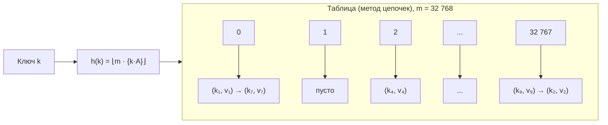
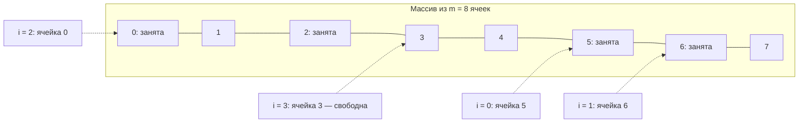
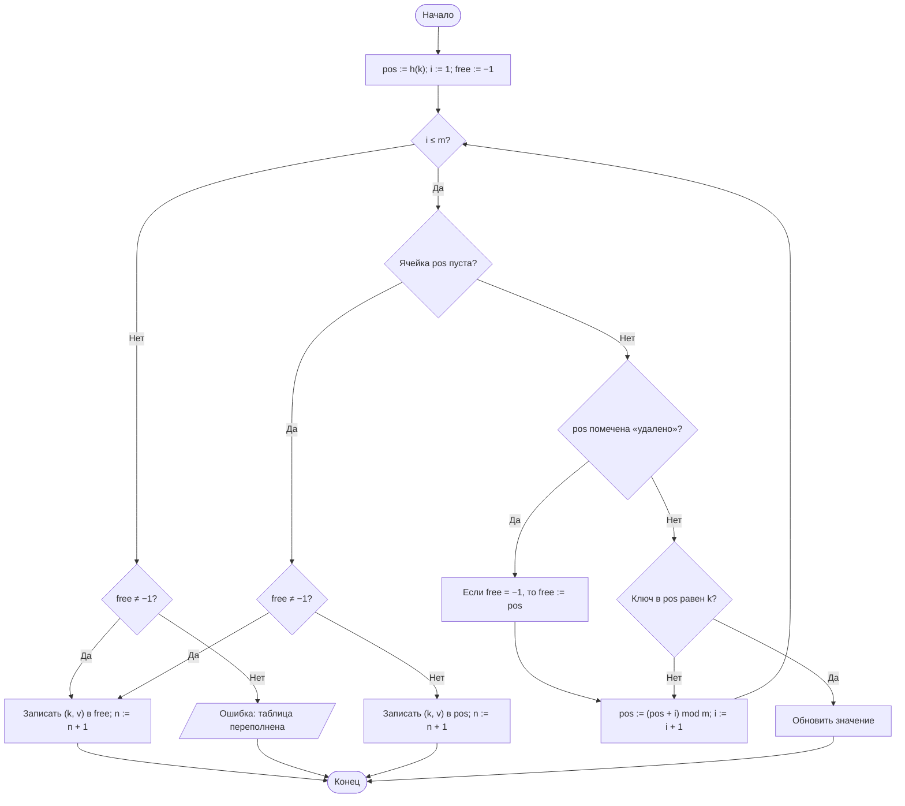

<!-- титул-начало -->
**МИНИСТЕРСТВО НАУКИ И ВЫСШЕГО ОБРАЗОВАНИЯ РОССИЙСКОЙ ФЕДЕРАЦИИ**

[Государственный Университет Управления]

Институт Информационных Систем

# Лабораторная работа № 5

## Хеширование и экспериментальное исследование методов разрешения коллизий

**Дисциплина:** Теория алгоритмов

**Направление подготовки:** 38.03.05 «Бизнес-информатика»

**Язык реализации:** Python 3.10+

**Вариант:** 14

**Выполнил:** студент группы БИ 2-1 Лапшенков Григорий Витальевич

**Проверил:** [должность, ФИО преподавателя]

[Город], 2026
<!-- титул-конец -->


---

## 1. Цель работы и задание варианта

### 1.1. Цель работы

Изучить принципы хеширования как способа организации данных с временем доступа $O(1)$ в среднем, реализовать хеш-таблицу и экспериментально исследовать влияние хеш-функции и коэффициента заполнения на её производительность.

### 1.2. Задание варианта 14

**Таблица 1. Исходные данные варианта**

| Параметр | Значение |
|---|---|
| Тип ключей | целые случайные, равномерно из $[0;\ 10^7)$, без повторов |
| Хеш-функция | У — метод умножения |
| Разрешение коллизий | Ц — метод цепочек; К — квадратичное пробирование |
| Число элементов $n$ | 25 000 |
| Размер таблицы $m$ | 32 768 ($= 2^{15}$) |
| Коэффициент заполнения | $\alpha = n / m = 0,7629$ |
| Дополнительное задание | В7 — подсчёт частот в логе из $10^6$ записей |

Необходимо: реализовать таблицу двумя способами (методы `insert`, `search`, `delete` со счётчиком проб), измерить время вставки и поиска, среднее число проб и распределение длин цепочек; построить зависимость числа проб от $\alpha$ с теоретической кривой; сравнить качественную и заведомо неудачную хеш-функции; сопоставить реализацию со встроенным `dict`; решить задание В7.

---

## 2. Хеш-функция и способы разрешения коллизий

### 2.1. Метод умножения

$$h(k) = \lfloor m \cdot \{k \cdot A\} \rfloor, \qquad A = \frac{\sqrt{5} - 1}{2} \approx 0{,}6180339887,$$

где $\{x\}$ — дробная часть. Метод зависит от всех разрядов ключа, и размер таблицы может быть произвольным — в том числе степенью двойки, как в варианте ($m = 2^{15}$), тогда как для метода деления это недопустимо. Пример: $k = 1234567$: $k \cdot A = 763004{,}3674$, $\{kA\} \approx 0{,}3674$, $h(k) = \lfloor 32768 \cdot \{kA\} \rfloor = 12038$.

В качестве заведомо неудачного примера для сравнения используется $h(k) = k \bmod 10$: функция принимает лишь 10 различных значений, поэтому почти вся таблица остаётся пустой, а все ключи концентрируются в десяти ячейках.

### 2.2. Метод цепочек

Элементы с одинаковым значением хеша хранятся в списке, присоединённом к ячейке. Проба — просмотр одного элемента цепочки. Ожидаемое число проб при $\alpha = 0,763$:

- успешный поиск: $1 + \frac{\alpha}{2} \approx 1,38$;
- неуспешный поиск: $\alpha \approx 0,76$ (просматривается вся цепочка, в среднем длины $\alpha$).

Трудоёмкость $\Theta(1 + \alpha)$ в среднем и $\Theta(n)$ в худшем случае.

### 2.3. Квадратичное пробирование

Элементы хранятся в самом массиве; при занятости ячейки проверяется следующая по правилу

$$h_i(k) = \left(h(k) + c_1 i + c_2 i^2\right) \bmod m, \qquad c_1 = c_2 = \tfrac12 \;\Rightarrow\; h_i(k) = \left(h(k) + \frac{i(i+1)}{2}\right) \bmod m.$$

Выбор коэффициентов важен: при $m = 2^s$ последовательность $\frac{i(i+1)}{2} \bmod m$, $i = 0, \ldots, m-1$, проходит **все** ячейки таблицы, поэтому вставка всегда находит свободное место при $\alpha < 1$. Распространённый выбор $c_1 = c_2 = 1$ при таком $m$ непригоден: $i^2 + i$ всегда чётно, и достигается лишь половина ячеек. Покрытие всей таблицы проверяется в программе (функция `self_test`). Соседние пробы вычисляются инкрементально: $pos_i = pos_{i-1} + i$.

Первичной кластеризации (как при линейном пробировании) нет, но ключи с одинаковым начальным значением $h(k)$ проходят одну и ту же последовательность — это **вторичная кластеризация**, из-за которой число проб несколько выше, чем при идеальном равномерном хешировании:

- успешный поиск: $\approx \frac{1}{\alpha}\ln\frac{1}{1-\alpha} \approx 1,89$;
- неуспешный поиск: $\approx \frac{1}{1-\alpha} \approx 4,22$.

Эти формулы — оценка для равномерного хеширования; для квадратичного пробирования ожидаются несколько большие значения.

**Удаление** выполняется постановкой метки «удалено» (tombstone): простое обнуление ячейки разорвало бы последовательность проб других ключей. При вставке запоминается первая встреченная метка, но поиск продолжается до пустой ячейки, чтобы не создать дубликат уже существующего ключа.

---

## 3. Схемы структуры данных и блок-схема

### 3.1. Схема таблицы при методе цепочек



### 3.2. Схема проб при квадратичном пробировании

Пример для $m = 8$ и ключа с $h(k) = 5$: проверяются ячейки $5,\ 6,\ 0,\ 3,\ \ldots$, то есть $(5 + 0) \bmod 8$, $(5 + 1) \bmod 8$, $(5 + 3) \bmod 8$, $(5 + 6) \bmod 8$.



### 3.3. Блок-схема вставки при квадратичном пробировании



---

## 4. Листинг программы

Программа содержит хеш-функции, обе таблицы (`insert`, `search`, `delete`, счётчик проб), контроль корректности (случайные операции сверяются со словарём `dict`), замеры, решение задания В7 и построение графиков.

```python
"""
Лабораторная работа № 5. Вариант 14.
Хеш-таблица: метод умножения; разрешение коллизий цепочками и квадратичным
пробированием. Целые случайные ключи, n = 25 000, m = 32 768.
Дополнительное задание В7: подсчёт частот в логе из 10^6 записей.
"""
import gc
import heapq
import json
import math
import random
import statistics
import time
from collections import Counter

M = 32_768                    # размер таблицы (по варианту)
N = 25_000                    # число хранимых ключей
KEY_RANGE = 10_000_000        # ключи — случайные целые из [0; 10^7)
A = (math.sqrt(5) - 1) / 2    # постоянная Кнута, A ≈ 0,6180339887
QUERIES = 10_000              # число запросов каждого вида
REPEATS = 5                   # повторов замера (берётся медиана)


# ------------------------------------------------------------ хеш-функции
def hash_mul(key, m):
    """Метод умножения: h(k) = floor(m * {k * A})."""
    return int(m * ((key * A) % 1.0))


def hash_bad(key, m):
    """Заведомо неудачная функция: всего 10 различных значений."""
    return key % 10


# ------------------------------------------------- метод цепочек
class ChainHashTable:
    """Хеш-таблица с разрешением коллизий методом цепочек.
    Проба — просмотр одного элемента цепочки (сравнение ключей)."""

    def __init__(self, m=M, hash_func=hash_mul):
        self.m, self.hash_func = m, hash_func
        self.slots = [[] for _ in range(m)]
        self.n = 0
        self.probes = 0

    def insert(self, key, value):
        chain = self.slots[self.hash_func(key, self.m)]
        for item in chain:
            self.probes += 1
            if item[0] == key:
                item[1] = value
                return
        chain.append([key, value])
        self.n += 1

    def add(self, key, delta=1):
        """Увеличить значение по ключу (счётчик); при отсутствии ключа — создать."""
        chain = self.slots[self.hash_func(key, self.m)]
        for item in chain:
            self.probes += 1
            if item[0] == key:
                item[1] += delta
                return
        chain.append([key, delta])
        self.n += 1

    def search(self, key):
        for item in self.slots[self.hash_func(key, self.m)]:
            self.probes += 1
            if item[0] == key:
                return item[1]
        return None

    def delete(self, key):
        chain = self.slots[self.hash_func(key, self.m)]
        for i, item in enumerate(chain):
            self.probes += 1
            if item[0] == key:
                del chain[i]
                self.n -= 1
                return True
        return False

    def items(self):
        return [(k, v) for chain in self.slots for k, v in chain]

    def chain_lengths(self):
        return [len(c) for c in self.slots]


# ---------------------------------------- квадратичное пробирование
class QuadHashTable:
    """Хеш-таблица с открытой адресацией и квадратичным пробированием
    h_i(k) = (h(k) + i/2 + i^2/2) mod m = (h(k) + i(i+1)/2) mod m.
    При m = 2^s такая последовательность проходит все ячейки таблицы.
    Удаление — с пометкой DELETED (tombstone)."""

    EMPTY = object()
    DELETED = object()

    def __init__(self, m=M, hash_func=hash_mul):
        self.m, self.hash_func = m, hash_func
        self.keys = [self.EMPTY] * m
        self.values = [None] * m
        self.n = 0
        self.probes = 0

    def _locate(self, key):
        """Возвращает (позиция ключа или -1, позиция для вставки или -1)."""
        m, keys = self.m, self.keys
        pos = self.hash_func(key, m)
        first_free = -1
        for i in range(1, m + 1):
            self.probes += 1
            k = keys[pos]
            if k is self.EMPTY:
                return -1, (first_free if first_free != -1 else pos)
            if k is self.DELETED:
                if first_free == -1:
                    first_free = pos
            elif k == key:
                return pos, -1
            pos = (pos + i) % m            # следующий член: h + i(i+1)/2
        return -1, first_free              # просмотрена вся таблица

    def _store(self, key, value, free):
        if free == -1:
            raise RuntimeError("Таблица переполнена")
        self.keys[free], self.values[free] = key, value
        self.n += 1

    def insert(self, key, value):
        pos, free = self._locate(key)
        if pos != -1:
            self.values[pos] = value
        else:
            self._store(key, value, free)

    def add(self, key, delta=1):
        pos, free = self._locate(key)
        if pos != -1:
            self.values[pos] += delta
        else:
            self._store(key, delta, free)

    def search(self, key):
        pos, _ = self._locate(key)
        return self.values[pos] if pos != -1 else None

    def delete(self, key):
        pos, _ = self._locate(key)
        if pos == -1:
            return False
        self.keys[pos], self.values[pos] = self.DELETED, None
        self.n -= 1
        return True

    def items(self):
        return [(k, v) for k, v in zip(self.keys, self.values)
                if k is not self.EMPTY and k is not self.DELETED]


# ------------------------------------------------------------- проверка
def self_test():
    """Контроль корректности: случайные операции сверяются со словарём dict."""
    probe_cells = {(i * (i + 1) // 2) % M for i in range(M)}
    assert len(probe_cells) == M, "последовательность проб не покрывает таблицу"
    rng = random.Random(1)
    for cls in (ChainHashTable, QuadHashTable):
        t, ref = cls(64), {}
        for _ in range(20_000):
            key, op = rng.randrange(40), rng.random()
            if op < 0.4:
                t.insert(key, key * 2)
                ref[key] = key * 2
            elif op < 0.7:
                assert t.delete(key) == (key in ref)
                ref.pop(key, None)
            else:
                assert t.search(key) == ref.get(key)
        assert t.n == len(ref) and dict(t.items()) == ref
    print("Самопроверка пройдена: таблицы согласованы с dict, пробирование покрывает все ячейки.")


# --------------------------------------------------------------- замеры
def make_keys(n, rng):
    keys = rng.sample(range(KEY_RANGE), n)
    present = set(keys)
    found = [rng.choice(keys) for _ in range(QUERIES)]
    absent = []
    while len(absent) < QUERIES:
        q = rng.randrange(KEY_RANGE)
        if q not in present:
            absent.append(q)
    return keys, found, absent


def timed_pass(func, queries):
    gc.collect()
    t0 = time.perf_counter()
    for q in queries:
        func(q)
    return time.perf_counter() - t0


def bench_table(factory, keys, found, absent, repeats=REPEATS):
    """Время вставки/поиска и среднее число проб для одной реализации."""
    t_ins = []
    for r in range(repeats):
        table = factory()
        gc.collect()
        t0 = time.perf_counter()
        for k in keys:
            table.insert(k, k)
        t_ins.append(time.perf_counter() - t0)
        if r == 0:
            ins_probes = table.probes / len(keys)
    out = {"t_insert": statistics.median(t_ins), "p_insert": ins_probes}
    for label, qs in (("found", found), ("absent", absent)):
        table.probes = 0
        times = [timed_pass(table.search, qs) for _ in range(repeats)]
        out["t_" + label] = statistics.median(times)
        out["p_" + label] = table.probes / (len(qs) * repeats)
    return out, table


def bench_dict(keys, found, absent, repeats=REPEATS):
    t_ins = []
    for _ in range(repeats):
        d = {}
        gc.collect()
        t0 = time.perf_counter()
        for k in keys:
            d[k] = k
        t_ins.append(time.perf_counter() - t0)
    return {"t_insert": statistics.median(t_ins),
            "t_found": statistics.median(timed_pass(d.get, found) for _ in range(repeats)),
            "t_absent": statistics.median(timed_pass(d.get, absent) for _ in range(repeats))}


def theory_probes(alpha):
    """Теоретические оценки числа проб (равномерное хеширование)."""
    return {"chain_found": 1 + alpha / 2, "chain_absent": alpha,
            "quad_found": math.log(1 / (1 - alpha)) / alpha,
            "quad_absent": 1 / (1 - alpha)}


# ------------------------------------------------- задание В7 (лог)
def make_log(total, clients, rng):
    """Лог операций: запись = идентификатор клиента. Активность клиентов
    неравномерна (распределение Ципфа: вес клиента с рангом r ~ 1/r)."""
    ids = rng.sample(range(1_000_000, 10_000_000), clients)
    weights = [1 / r for r in range(1, clients + 1)]
    return rng.choices(ids, weights=weights, k=total)


def count_list(log):
    """Решение «через список и in»: два параллельных списка."""
    seen, counts = [], []
    for c in log:
        if c in seen:                       # Θ(u): линейный просмотр списка
            counts[seen.index(c)] += 1      # ещё один просмотр
        else:
            seen.append(c)
            counts.append(1)
    return dict(zip(seen, counts))


def count_hash(log, table_cls, m):
    table = table_cls(m)
    for c in log:
        table.add(c)
    return dict(table.items())


def count_dict(log):
    d = {}
    for c in log:
        d[c] = d.get(c, 0) + 1
    return d


def count_counter(log):
    return Counter(log)


def top10(freq):
    """10 клиентов с наибольшим числом операций (при равенстве — по возрастанию id)."""
    return heapq.nlargest(10, freq.items(), key=lambda kv: (kv[1], -kv[0]))


# ------------------------------------------------------------- графики
def make_plots(res):
    import matplotlib
    matplotlib.use("Agg")
    import matplotlib.pyplot as plt

    # Рис. 1. Число проб от коэффициента заполнения
    sw = res["sweep"]
    al = [r["alpha"] for r in sw]
    fine = [i / 200 for i in range(10, 195)]
    fig, axes = plt.subplots(1, 2, figsize=(11, 4.3))
    for ax, kind, title in ((axes[0], "found", "Успешный поиск"), (axes[1], "absent", "Неуспешный поиск")):
        ax.plot(al, [r["chain"]["p_" + kind] for r in sw], "o-", label="цепочки (опыт)")
        ax.plot(al, [r["quad"]["p_" + kind] for r in sw], "s-", label="квадр. пробирование (опыт)")
        ax.plot(fine, [theory_probes(a)["chain_" + kind] for a in fine], "--", color="C0", lw=1,
                label="цепочки (теория)")
        ax.plot(fine, [theory_probes(a)["quad_" + kind] for a in fine], "--", color="C1", lw=1,
                label="открытая адресация (теория)")
        ax.set_yscale("log"); ax.set_xlabel("коэффициент заполнения α")
        ax.set_ylabel("среднее число проб"); ax.set_title(title)
        ax.grid(True, which="both", alpha=.3); ax.legend(fontsize=8)
    plt.tight_layout(); plt.savefig("img/lr5_alpha.png", dpi=170); plt.close()

    # Рис. 2. Длины цепочек и распределение Пуассона
    pt = res["poisson"]
    plt.figure(figsize=(6.4, 4.2))
    xs = [r["len"] for r in pt]
    w = 0.4
    plt.bar([x - w / 2 for x in xs], [r["obs"] for r in pt], w, label="опыт")
    plt.bar([x + w / 2 for x in xs], [r["exp"] for r in pt], w, label="Пуассон, λ = α")
    plt.xlabel("длина цепочки"); plt.ylabel("число ячеек")
    plt.title("Распределение длин цепочек (n = 25 000, m = 32 768)")
    plt.legend(); plt.grid(True, axis="y", alpha=.3)
    plt.tight_layout(); plt.savefig("img/lr5_chains.png", dpi=170); plt.close()

    # Рис. 3. В7: время подсчёта частот
    v7 = res["v7"]
    plt.figure(figsize=(6.8, 4.4))
    sizes = [r["N"] for r in v7["runs"]]
    for name, style in (("список и in", "o-"), ("своя таблица (цепочки)", "s-"),
                        ("своя таблица (квадр.)", "^-"), ("dict", "d-"), ("Counter", "v-")):
        pts = [(r["N"], r["t"][name]) for r in v7["runs"] if name in r["t"]]
        plt.plot(*zip(*pts), style, label=name)
    ext = v7.get("list_extrapolated")
    if ext:
        plt.plot([e["N"] for e in ext], [e["t"] for e in ext], "x--", color="C0",
                 label="список и in (экстраполяция)")
    plt.xscale("log"); plt.yscale("log")
    plt.xlabel("число записей лога N"); plt.ylabel("время, с")
    plt.title("Подсчёт частот клиентов в логе"); plt.grid(True, which="both", alpha=.3)
    plt.legend(fontsize=8); plt.tight_layout(); plt.savefig("img/lr5_v7.png", dpi=170); plt.close()


# ----------------------------------------------------------------- main
if __name__ == "__main__":
    self_test()
    rng = random.Random(14)
    res = {}

    # ---- 1. Основной эксперимент: n = 25 000, m = 32 768
    keys, found, absent = make_keys(N, rng)
    chain, t_chain = bench_table(lambda: ChainHashTable(M), keys, found, absent)
    quad, t_quad = bench_table(lambda: QuadHashTable(M), keys, found, absent)
    res["main"] = {"alpha": N / M, "chain": chain, "quad": quad,
                   "dict": bench_dict(keys, found, absent)}
    print(f"n = {N}, m = {M}, α = {N / M:.4f}")
    for name, r in (("Цепочки", chain), ("Квадр. пробирование", quad)):
        print(f"{name:<22} вставка {r['t_insert']:.4f} с, поиск {r['t_found']:.4f} с, "
              f"проб: вставка {r['p_insert']:.2f}, найден {r['p_found']:.2f}, не найден {r['p_absent']:.2f}")
    print("dict", res["main"]["dict"])

    # ---- 2. Распределение длин цепочек и пуассоновская модель
    lengths = t_chain.chain_lengths()
    alpha = N / M
    cnt = Counter(lengths)
    res["chains"] = {"max": max(lengths), "empty": cnt[0], "m": M}
    res["poisson"] = [{"len": j, "obs": cnt.get(j, 0),
                       "exp": M * math.exp(-alpha) * alpha ** j / math.factorial(j)}
                      for j in range(max(lengths) + 1)]
    for row in res["poisson"]:
        print(f"  длина {row['len']}: ячеек {row['obs']:>6}, по Пуассону {row['exp']:>9.1f}")

    # ---- 3. Зависимость числа проб от α
    res["sweep"] = []
    for a in (0.1, 0.3, 0.5, 0.7, 0.9, 0.95):
        n = round(a * M)
        k2, f2, a2 = make_keys(n, rng)
        ch, _ = bench_table(lambda: ChainHashTable(M), k2, f2, a2, repeats=1)
        qd, _ = bench_table(lambda: QuadHashTable(M), k2, f2, a2, repeats=1)
        res["sweep"].append({"alpha": a, "n": n, "chain": ch, "quad": qd, "theory": theory_probes(a)})
        print(f"α = {a}: цепочки {ch['p_found']:.2f}/{ch['p_absent']:.2f}, "
              f"квадр. {qd['p_found']:.2f}/{qd['p_absent']:.2f}")

    # ---- 4. Качественная и неудачная хеш-функции (n = 5000)
    nb = 5_000
    kb, fb, ab = make_keys(nb, rng)
    res["bad"] = {"n": nb, "rows": []}
    for hname, hf in (("h = ⌊m·{kA}⌋", hash_mul), ("h = k mod 10", hash_bad)):
        for cname, cls in (("Цепочки", ChainHashTable), ("Квадр. пробирование", QuadHashTable)):
            r, tab = bench_table(lambda: cls(M, hf), kb, fb, ab, repeats=1)
            distinct = len({hf(k, M) for k in kb})
            longest = max(tab.chain_lengths()) if cls is ChainHashTable else None
            res["bad"]["rows"].append({"hash": hname, "method": cname, "distinct": distinct,
                                       "longest": longest, **r})
            print(hname, cname, distinct, longest, {k: round(v, 3) for k, v in r.items()})

    # ---- 5. В7: частоты клиентов в логе из 10^6 записей
    TOTAL, CLIENTS = 1_000_000, 50_000
    log = make_log(TOTAL, CLIENTS, random.Random(7))
    sizes = [10_000, 20_000, 50_000, 100_000, 200_000, 500_000, 1_000_000]
    LIMIT = 240.0                                     # предельное время одного замера, с
    solvers = {"список и in": count_list,
               "своя таблица (цепочки)": lambda lg: count_hash(lg, ChainHashTable, 131_072),
               "своя таблица (квадр.)": lambda lg: count_hash(lg, QuadHashTable, 131_072),
               "dict": count_dict, "Counter": count_counter}
    runs, list_skipped = [], False
    for size in sizes:
        part = log[:size]
        row, reference = {}, None
        for name, func in solvers.items():
            if name == "список и in" and (list_skipped or (
                    runs and "список и in" in runs[-1]["t"] and
                    runs[-1]["t"]["список и in"] * (size / runs[-1]["N"]) ** 2 > LIMIT)):
                list_skipped = True
                continue
            t0 = time.perf_counter()
            freq = func(part)
            row[name] = time.perf_counter() - t0
            if reference is None:
                reference = (len(freq), top10(freq))
            else:
                assert (len(freq), top10(freq)) == reference, f"результаты расходятся: {name}"
        runs.append({"N": size, "t": row, "unique": reference[0]})
        print(f"N = {size}: уникальных {reference[0]}, " +
              ", ".join(f"{k} {v:.3f} с" for k, v in row.items()), flush=True)
    freq = count_dict(log)
    res["v7"] = {"total": TOTAL, "clients": CLIENTS, "unique": len(freq),
                 "top10": top10(freq), "runs": runs}
    # экстраполяция времени решения через список степенной зависимостью по двум последним точкам
    meas = [(r["N"], r["t"]["список и in"]) for r in runs if "список и in" in r["t"]]
    if meas[-1][0] < TOTAL:
        (n1, t1), (n2, t2) = meas[-2], meas[-1]
        p = math.log(t2 / t1) / math.log(n2 / n1)
        res["v7"]["list_exponent"] = p
        res["v7"]["list_extrapolated"] = [
            {"N": s, "t": t2 * (s / n2) ** p} for s in sizes if s >= n2]
        print(f"показатель степени {p:.2f}; оценка для N = 10^6: {t2 * (TOTAL / n2) ** p:.0f} с")

    with open("res/lr5.json", "w", encoding="utf-8") as f:
        json.dump(res, f, ensure_ascii=False)
    make_plots(res)
```

---

## 5. Таблицы измерений и графики

### 5.1. Условия измерений

| Параметр | Значение |
|---|---|
| Операционная система | Linux 6.18 (x86_64), виртуальная машина |
| Процессор | Intel Xeon, 2,10 ГГц, 1 виртуальное ядро |
| Оперативная память | 4 ГБ |
| Интерпретатор | CPython 3.12.3 |
| Способ замера времени | `time.perf_counter()`, перед каждым прогоном вызывается `gc.collect()` |

Ключи — случайные уникальные целые из $[0;\ 10^7)$. Для основного опыта сгенерированы 10 000 запросов успешного поиска (случайные ключи таблицы) и 10 000 запросов неуспешного поиска (случайные ключи, отсутствующие в таблице). Время — медиана 5 повторов; число проб детерминировано. Для зависимости от $\alpha$ и сравнения хеш-функций использован один повтор, так как важны числа проб, а не время.

Перед замерами выполнена самопроверка: результаты обеих таблиц при случайной последовательности вставок, поисков и удалений совпали с `dict`; последовательность квадратичных проб покрывает все $32\,768$ ячеек.

### 5.2. Основной эксперимент: $n = 25\,000$, $m = 32\,768$, $\alpha = 0,763$

**Таблица 2. Время операций**

| Реализация | Вставка 25 000 ключей, с | Поиск 10 000 найденных, с | Поиск 10 000 ненайденных, с |
|---|---:|---:|---:|
| Метод цепочек | 0,0108 | 0,0050 | 0,0040 |
| Квадратичное пробирование | 0,0132 | 0,0054 | 0,0078 |
| Встроенный `dict` (эталон) | 0,0013 | 0,0009 | 0,0006 |

**Таблица 3. Среднее число проб (проба — просмотр одной ячейки или элемента цепочки)**

| Реализация | Проб на вставку | Проб, найден | Проб, не найден |
|---|---:|---:|---:|
| Метод цепочек (опыт) | 0,38 | 1,39 | 0,76 |
| Метод цепочек (теория: $1 + \alpha/2$; $\alpha$) | — | 1,38 | 0,76 |
| Квадратичное пробирование (опыт) | 2,03 | 2,07 | 4,88 |
| Открытая адресация, равномерное хеширование (теория: $\frac{1}{\alpha}\ln\frac{1}{1-\alpha}$; $\frac{1}{1-\alpha}$) | 1,89 | 1,89 | 4,22 |

Число проб метода цепочек совпадает с теорией $1 + \alpha/2$ и $\alpha$ с точностью до сотых. Для квадратичного пробирования теория равномерного хеширования даёт 1,89 пробы при успешном и 4,22 при неуспешном поиске против измеренных 2,07 и 4,88: превышение примерно на 10–16 % объясняется вторичной кластеризацией. Среднее число проб при вставке (2,03) близко к $\frac{1}{\alpha}\ln\frac{1}{1-\alpha} \approx 1,89$, так как вставка k-го ключа обходится как неуспешный поиск при заполнении $k/m$, а усреднение по заполнению от 0 до $\alpha$ даёт именно эту величину.

Время поиска у обеих реализаций почти одинаково (0,0050 и 0,0054 с на 10 000 запросов), хотя квадратичное пробирование делает в полтора раза больше проб: в интерпретаторе Python преобладают накладные расходы вызова метода и вычисления хеша, а не само сравнение. По сравнению с встроенным `dict` реализация цепочками медленнее в 8,5 раза при вставке и в 5,8 раза при поиске, квадратичное пробирование — в 10,4 и 6,2 раза.

### 5.3. Распределение длин цепочек

**Таблица 4. Длины цепочек (метод цепочек) и модель Пуассона**

| Длина цепочки | Ячеек (опыт) | Ячеек (Пуассон, $\lambda=\alpha$) |
|---|---:|---:|
| 0 | 15 316 | 15 279,5 |
| 1 | 11 609 | 11 657,3 |
| 2 | 4 442 | 4 446,9 |
| 3 | 1 136 | 1 130,9 |
| 4 | 228 | 215,7 |
| 5 | 35 | 32,9 |
| 6 | 2 | 4,2 |

Пустых ячеек — 15 316 из 32 768 (46,7 %); по Пуассону ожидается доля $e^{-\alpha} = 46,6$ %. Наибольшая цепочка содержит 6 элементов при средней длине 0,76. Опытное распределение практически совпадает с пуассоновским, то есть метод умножения распределяет ключи так, как если бы хеш-значения были независимыми и равномерными.

![Рис. 1. Распределение длин цепочек и модель Пуассона](data:image/png;base64,iVBORw0KGgoAAAANSUhEUgAABEAAAALKCAMAAAAF2tT5AAABgFBMVEX////+/v79/f38/Pz6+vr5+fn4+Pj39/f29vb09PTy8vLw8PDv7+/u7u7t7e3s7Ozr6+vq6uro6Ojn5+fl5eXj4+Ph4eHf39/c3Nza2trY2NjW1tbV1dXT09PS0tLR0dHQ0NDPz8/Nzc3Ly8vJycnGxsbDw8PBwcHAwMC/v7+8vLy4uLi2tra0tLSysrKwsLCurq6rq6vojTyoqKimpqaioqKfn5+cnJyXl5eRkZGOjo6MjIyKioqHh4eEhISBgYFIh7L/fw5/f396enofd7R0dHRwcHBtbW1qampoaGhmZmZkZGRgYGBfX19cXFxZWVlWVlZSUlJOTk5LS0tGRkZCQkJAQEA/Pz89PT07Ozs4ODg1NTU0NDQyMjIuLi4pKSkmJiYkJCQhISEgICAfHx8eHh4cHBwbGxsZGRkYGBgXFxcVFRUTExMSEhIREREQEBAPDw8ODg4NDQ0MDAwLCwsKCgoICAgMBwMHBwcDBwkGBgYEBAQDAwMCAgIBAQEAAAAsEsmeAAA380lEQVR42u3dB1sT6xqo4YEAUiwUpdoQECmKbARBEPeBjYqogMgSkK4UKdJzOCEz718/U9PbsCRB8jzXtRbzhcAkIXM7LYmiEBEREREREREREREREREREREREREREREREREREREREREREREREREREREREREREREREREREREREREREWW+nO/ymkfhAstfkxc8CmG1iJlva/p1KY/GX95L2S761wg9Hp7e9B2vfG4NXCTBoq9fMbx4eLg4XOHukgup+fXk4i/f0cp4u3NJyYuxhf2z3bnhysjrVkloVc7Fje+X9r0/p9/U2uPbQ3O7Z4eLo/X2uFc2iniexQDEaLedh+OvrmBd+v/1L1kLPB++lKQASOuu9Y2dVjeXXEw/Azfz6w3zgvZT5wJvbyJA9q5ZFxZ9ci4Zsi7oPLTH6rB1Qd5P1vGiABm9d+9eQ8+8/ijf4/H4m+uVw3//z6NfVkc6GpoGNkX+yXEA+XLPLvLadw/F//bJ4zdeObyb+iUX1NLX4e62R22vlkRmco0LukWbHmitbx9TRXrCr5vn3KN7b/QlwPZjRqfn5eP6tsGFN9b6iF9korPx6YhXHJpfyU4hz7RwQCxtPV/0B4vH42/eA7Iin/79b5lrt9goWxHpdgCJ+3un7Ss9UeVr6pdcUB7nq/5UfmpMdI3Z2ybPNdkrjn8XmqypUTnrdnZ2mP/Xf4+15lLvk13rt1f4pZenWixAlBqRw1wekL+3VpE/uY3wTF/xSAbII5Fpa2pMpD7VSy68JpGR8EsmRZ7Hvm6lKkv2/g9N3oR/b1c27KlxkfvW1FeZ56kWExD94ZJbhrG9E8vHvq3pvuCqWk7H+OqJb+1L7/Wo3U8txveHRKoK+uf3jxb68wM/1DC6dOhd/dwUnFfwp5xZKrVvF/dO1yfbY+2TabFn/nxizXu4OFIZuIKzNjpk7/36JD+tCwrXgs/1G4Mz277t6d786Psc2NJ1fk5ReiJ2qP10fs8Dvz2/nsANMn4+/Bd+C/6ikIUt4gEIe9icu9AxuX66tzBcFrhDgc35OPcjcF97Rabywm7FmOzkBu5Ni9I5vX26+v72uZ8ZxeIsWfEBGRbnqMRjkeFUL4nOuME5PTM7R4u9+j/0OV3T297Fgbxz3/S7Iu/CL+kTGYh93UFx9mp8lqOILcBjmQ3e0UfW1EuRWtiICciWSLm+/qc6T/Llavsbt+dCF/zYgNTPW+PFUnsbc1Szr/E2Nz4gb87sCyYK4wFSPuvsB+tOCoh+gfNcf7Zn/9hi5b8C5JucE5CoByAGIMVf7eFRRzxAIu+Hc197NJkuCL8VmzIVvDetn60f2zr3s/2mPs9kgMyI2ELlncg/qV4SE5DWSesGT3oKJqypqXOvDw9L5HZGv8ir2NddFr918/K8MqkouRXVwW2d+ZA1EM2+uE7+wJ7qKwlIuSanOv8e7dvr9oamF5OaLFnP0Js/RL73Nj16NrxqAzJq738aDALyXSbaH3XpC/us9WfXnwTfep409HwP+VfH3hnXFpjliP4c7W191KUvR5+Dt6fHuJKzvJasiP/Ti8am/g1R25IAUukNAPJMlV+DTx+1f/DLUnEMQMybPx8GSJt9j8IA6ZLzAhL1AAR3RfbYvzJX3/xe7GlofXsm/ubYgETdD/u+dqkyE/HPZU3QZX0GszLV+ahNX/OePe8z47nIuHOfVhcPvWuTLzyR19mRfWdyUbZTvSQmIHPyWX8CLYu8fCvjTx91LelT59oTVPZY//tsl4Rf+kX/+8bb2vka2Bx7UzS8LaKZq0H22oZ1Gx6cBgzN2Xe27CgckHfWQ5lTY3+nTbWXVH1RGLF2rOXesQAJeaI6gFibj7mT9kPeI5q13uoZF7+9JuOxF67AL9Dn/TrHkeRJYEP+if0981d/lG1r4/PWkqx4EgMyKWtb1ixu7MqktU7zVI3csDXWVSVyudefKpX2PQoFpGhNl/FcgEQ/AMF/x5278NLZCmnzy6rHukM5YYBE3w/rvnacyfeIRcSwriNkfcp6iD9G7XaQyL7FfmLkfg/8vsBVF2vCr1MQ2MpRlCmR/NQuiQ2I9Jn7KA9lR3OmFqOvJDE3BENFM/vVFH5xvV9+FcSc8weRLmuqW38OLzmHgS2cc8dEG3/e0D7ile9lzk/8I5uwEQXItUf6UqW1RKhtUlutyreckItjA7JorXjcOrL+7Mvy0dmGP3VWQfSN6rGwX/DV2bum5G04qyDt9j5xG5DKM+dQgPGd1oSA6PZ02QveoOw7y9eErEfe50nxRy73vfZ6dgQgw+J9cj5Aoh+AaEAW5aQ8gLexsL4WqQgDJPp+mPe17VQWb8TYmG8M/l0WrD9Zrb1gugdEvy1z9qR3ore5vmVgRWTjTth1SoPXMf6ZuZXaJXHWQAKPbWBKKzkfIOpwxINzbVHiHDu5ti+/bVle6VvJMtNcWNK5GlwhfmZtQG/0XVNC7gTnkimxdlr6A0+1nPJafU17TNbsB7ZDSQpIf/Bf9zJzL1ZbcEPSZuKWvWvL+QXFIUfEJmXV3qto762yAekVtSi4U+9NIkA8S/qyYC9434NHpPvsdYuQpuQwcrnvs5/a4YBUeWWo6lyAxHgAogCpCGwjGFc3zkV4EThyGvd+GPe1+USWyqL+kjpCNcG/i/P3OJK34Ve7F1lVzOeFvlJ06OwDsxfHa/oG0WT4EQyRmZDVujupXRIbkFeROyv6I1eerkfd9OtRv6j23oOW1z/OJksjVzmncmLOuCtwEogBsMyYK4QVW84u0+pJn7VszAaPb42GnLhKQUC2P9u7mZXOr0fOfkv70b+RHJDm4PO8NfIfC3sVttbeG+D8gidhV/IGfuXdEEA+hl1n1PrGoP38GQ0DpE/8D+wFz3MW9mONEfd5TrYil/s39j8r4YDo20SFIYD02PP9khyQGA9AFCBtIWsH++a+inKfbHfdCM4/xv3Q72vjQchhrNCDMFIW/Ls4x7XWrLU+tz06kLNnkRfmr4h2+6LWQNoD25LBqebzPaeLvsrP2+H7VJduxr7q1+CzY0ACJ4T02YeBm3bld19lXmnnUvAMEeO3ccJlGCDGLtGawL9o+ZMRZy5/lVMlOSC1QdK7rD+GRB7raLX/cXF+QWf4+mhgRbIsBJCpsKt8Cl9lklBASvfkvbPglUn0kaKQ1uyt65Dl/p0NWBgg+g3uVEIAiXtKdzQgMR6AKEC6ApvfxhbPkr3dEHpfY9yPT3KwK5r4HsTamq+M+LuEHs5xVd2OqC9ibta8uKh9IC3xp1xX5g1sg1h/i9U4R7PvqMEbp2/F/g7ujzbWmvLXxGudO1uyJF7nlTxvOY4beydq8N/i2Re1xZ7AMYHzAGI804JrmrWBf1I6Qn+BftWBkPVR58CMPzcEEH3mIVe5kwCQMdm56Swv+sbBRMiPRWyyFpzZa+Ihy/2E/IgCRN8mmlbOCUiMByAVQJTulVBAYtwP4xD01uNtWYxaEvV/GR+mAEgqmzDVG6LFOgTyNPJsij94FCY5IKlswgRWLE48ITCsx9vmeB1yh9oDh60d9DoksPrWHTwM/Mk824HiAbLpHIhV3lvLyXk2YXQrolaAjY3HmtBf0Bq1g8/cc7uihACiz7w46gbH2gfySDV3qFjLS54WsbEeVqNzYDVkuV+0d9SEAvJK/PfCAHGxDyTGA5BwE2YvcLi14q6xaGzEux/6vHfuGYdYo07J6g3ewESApLATtfJnrL+MtYyFA/IHzwNJDkgqO1HtxgN7o40TZjZr4l1vSfwVITt0nLWRImvydXDXa11wX8kXOc3BjbiA3Ao+d75by0mf252o5eYx9ZGoWS3ap+U4v6BUi/HimzV7kbEB6Q9uzScGZFYWPcHlZVF+eeLe5X5nB2dwuS88tW9vCCBl++Y+3/MBEuMBSLQTNeT5GbbcR9+PT+J9ZD7M/sg9O83Bp/u/A6RiJd5pmwMRmzAhZ5k2RZ13Gv+SiwdkJvDvTpdftusS/FMyFRytyLH9YD+wzmgYCC4LD4Lnti5zLnsiQMoDZ/Y22Gvqrg7j3rSO3uf8lJ3I44x3nRXCwC+YEV91xJXuOX8zGxB95tOpANJtrwPZy8tQ4HBGjObloDBiuX9qv/oqFJAx6y6cD5AYD0Csw7jHZYHt6o5YgETfD/uQ9fUNWY54VWiRL3Dk+F/tAyldEhmM+Z285cijKH/qtTB/eB9Ipc/eIlWencnOg7jXGzV2coVq+DTwxDIWgufBl5f2BTZhrmvGvjaKB0juniyax7xvLzub+uOBf01zb8cFxHrO5UzY/wzqq/D/2FuoOc+tHVGTztMn8Av0bZhF5wnZ+thcCHRTKkIBMdZoRuxNqqJXufEA2d6w/9T28nJrXw6cjararvB7rG/Zvo1Y7suWZCc/ApBFa5vonIDEeABin0hm/pvXemadSBYFSPT9cE6aa4t6uYfyT2AV/N8AUrIQuVHbYb8opSDqMK75UlZz9aLZH/La26SXfIqxcvHvAWl19sPdnAs8w05l71HcHyj4Lbshp5dVHMmyeZDo4Yl4jd0cJcfit9ZVq7ZEtX97W6T1ABL+dHmnL9Xdjc2DO+qsvZw4p7I/HV4ZiguIeSp7p77qOOdx1Nkaaqtv6nq7buwUyXuoS7Bg7fpqMw78lNnmH4y01zd1Di8bJ7BW9q2Kc96oA0iJ/u/hYl9zffPLz4cS90xUkZM7YctLu1/8412NDe2vZ7TPYRtgLw9Ee3rPPpV9w9i/WTv4K/A7g4A4K1WpAbJWbCfyubggxgMQCxDjVPaF7kctb33if6LEAiT6fgRe9zMaed6f/q+keudfA1Kg/9Unw3ds//w12v24/olxItlm5Ck1xnt9jDQ3vTkJe/ePZJdcDCBD6vRA26NHz0Z29L+duXrWeCL+l6F74MPrlPCViV6RH72Nj98cOhuDr0XORtvrn7z5HdzEHJFD3hAkESDF3+03OewLvDLjzveIF9PFAKR+wT7b2V4p94z4AyeoNUW+Ai9wpvUrrzPWuqwVGWd1wwFEuRU8knuYAJDBiOWldTPwY+/Dl3WJPMKq/7j/lRINyGMldUCijjZHPgCxAIl6MV00IFH3IwBI8ar8DN+/XOZzdl38C0Cqog82Bd/oaz56b+S53pFsIvDi+D8KSPB2T96MvCTWCwL1Z1ZD+D4e+7Qxv7NHbzjwytJP9mpY7vr5TqzJHkCUgoGFE+/qWH3IS7tyOifXT09/fnlZHBeQqmsDCwfHiwPBVcLqkfmds+Plyb4KJS4gSsWb2e2zk9WpAWNnyODi+3sht8t5+jwZWzrw7y1+fFEUdx+IrF6LXF4Ke6c2Tk83vw03KUkAGf0+UqVEAzKu/CtAIh6AmIDom9mTG779heGo44Jx70cAEKVZjXwqf3KOQ/5ZQJ68mVreOTtY/vws1stjK4aXjo6Wwt8BNdkl65E7tv4IICVdo7Orx76dubcN0aTEAKTCH/lqG+Xe+5WT46X3wfM8Hrxb2PcfLo0FnkSt6XpPk6xqKOnZvVXBvQTWDwxl6KZ+C3tWRtysP1LPn3hfsHN1T4s66fZSVn3uc0wz3/gFv6sagABIxgDRn91Tf8PT5WW8F/Bd/urUv8NoAAGQc1Tl/Sue3p+l9W99po8HTt2htAJyeylsza93KVPvTPtxqTH+zfojdR+PZuwP0Tn0lGfjBZb/Zug2j0ImACEiAhAiIiIiIiIicltp58j0Qeg5jS3ja6fbc86HDD3+sn26MhJ4J7bEQyLKsl6Fv7dV7qiItqc6L8HoVUXVeVm3X72UeEhE2Vbf+uTgQBCQd7LdU6zk1Q2ab3/S4JcP15X6ZZnPST4koqzLeGnp4wAgzdpx6BsnTcmsYcNdv/WZwImHRJSVBQGZCnu3txtn9lslTZlv4ZJ4GJGqHRLRZUndSAMg1/1h75DwTLQb9o6SnaTDiDThb0Z0adIO0wBIm/g8Pd9PDmZfmm/oNeB8/mab+TEpiYcRHR6yZkd0aTpMByC98uu9aL/9Il8MQd7KgnX5Q/O9mxIPgzfUTI7KieiydJQOQF6LJhO3leIh6726xpyPCakxP24v8RBAiLIckEGRZXPjZUL2C84JCJswRFm6CdPnfB5Kk2nCuTZhAIQoSwHpdD6B7Yb94dTB3aSlyYYAQpTlgNwNAaTTPFBrfSpR4LhtgiGAEGU5IDkbwU2YxrBTxSaUZEMAIcpyQJSRwE7UbY9Jw4xxsnrtmXPueqIhgBBlHSC5paWlT0X0/5foo9JdmagwD+OaayINfhktUR4uBV89l2AIIHRZys2/lu0VeNKzQAY/A8z8lIzmQ9F2z0Q+WN91XrBflcoQQOhS5CmvraO6ypKc9AOiVI3+9O1+DXxI6rnfUAhAKEPlVIGHVVnO37tAAghlqLK6uttFWb8JU3izuq6uBECIXFZdV8k7XBlbcvoDASBELpeburrrPApGN+vqPABC5KqCurpCHgWjwrq6fAAhctW1urprPApRjwSAEAEIgBABCIAACAEIgAAIAQiAAAgRgAAIEYAACIDQJVhs/ucuAAEQAhAAARAiAAGQ1Ppflv+d6VID4umd3fOuvK0wpocCb34hnxTzvTCC1/spLcb/gg0ByOUE5P+4jYUKQM4NSNG0iO9A5HejCYh3y+w4DiDzxjd9cmB8GQAQAKFsB2RMTnrylPoF2bhuAPLJunQoDiBm36SHTRgAIQDRjVCl2/hadiyvAQRACEBcAdIvq9aE+UGMAAIgBCAuAPksH62JDjnzAAiAEIC4AeSrDFsTD0VuxQBEz7cx2QIgAEIAEguQkYSAmEdkRHoBBEAIQGJswkwk3YSp/irHhQACIAQgkfXLuvXGxIl2ot4WaQAQACEAiaxKtTRIeBi3FEAAhAAkVmNy1J3kRLKSz3LEJgyAEIBEZ5zKfho8lT0SkPn5+WUvO1EBhAAk9u/z9M4dnK68q1BiAqJ3tjHZqgAIgNBVA4RHAkAAhAAEQACEAARAAIQABEAAhAAEQAAEQAhAAARACEAABEAIQAAEQAhAAARAAARAeCQABEAIQAAEQAhAAARACEAABEAIQAAEQACEAARAAIQABEAAhAAEQACEACRzDcnOZCWAAAj99YB8kpCG0nQfBnZElj0AAiCUSUD+xPPkk/i27NS0AaIoj73SCSAAQn8/IN+cyZ9pBET5IF8ABEAIQM5Xs/iu/w2AlHaOTB/YH7Bl9+BMpMpZk/qyfboyclNJaQggdOUBeSwnJdawTfb0GdUOfVvz7U5359hXqnq3dHyw9L4hetD2Zdu3Mf7InG6Rn0r4RGQ5G/LSxb2+O7F9vNhnfHrvy/QC8sraOxR6y+ckAEivKqrOy3plKkMAoSxYA1l2FtEJGdX/Py9ysqcvMePWhS9OrfG3qMGIiLqnidqbGiC3vDKd+p3u8MnZich7ZVEtTy8gfeuTgwNhgLyU7w4gDX75cF2pX5b5nORDAKFsAGRAZs3Rda8YH1b3vueOohT3Hki3ueHhl6mHinLjxUjk4IXIyHWlYlzUppQAea17czvV+1x9IqPFOc998lTm0rwJYxwrehwKSOnuxlMHkCmZNWy465fnyYcAQtkASPmZVJvr37IUcrUXMmN8WZCp3MBloYOcVRkzvubOyddUAPGsiyb9YRdVSVifQr71Xn4aC/JbWTc+AjztO1HDAPkkXS02IDfO7ENJUzKZdAgglB07USdl2PgyJwMhV7suXn0RvityN7hbInTwyPlHuUO0khQA6ZLDtzIfdlHlVljvQr61at0yfUGWugwD0iz/KA4gz0S7Ye8o2Uk6BBDKDkCeyZq+YlErfvPjcpWnk2un5ipBqaL0yFrwJ8MGL2XVmigRaU4BkFl5Wy1Sm9pdLhRpM74WqbKiZBaQvKWzuwFABmTT2d8sZcmGAELZAYhnU1oVZVimzAs/6HSc7mxtiVQaOy5mQvdixBzsGSvuLcFNkZiAPBK1Wvme6mHjCmfFY1lGMgzIa+MWOIC8lQXr0oci95MNAYSyAxDdjs9K7rq1Af9U5I1xFNJjLjOJAPkeDohqbYj8jg3IJ2O3QJ8spwyItX00bdCWSUAqTzaLg4CM2fublRqRpmTD4A01k6PyVPuvy/7jtnLKou48uFucZ+USkLxYfZYZZ/KnDJtf78rJrXbZKTKmP8ln87JKkZq8vJeyFvzJsEGvbFkTN0Va8/Ja5ac1DEyEdefUuNIdvzSFXFgdsQ8k+B19s8i84q1TeR7yA8V3H9wJPCxHaQHki3kwCkAIQOIDkjcjvRPy3pyclj7za7cJyH2Rh4GfDBs0ijwwJzpFK00KyJAsGF++ytuQC2vCj8J8DvnWD+tW9OirQxkFpMNa6WIThtiEib8Jo/TIglfqFeuQjHk05NqitczMhx7GDR3krFjHXVM6jJu3YZ1V0i0buSnd5w+ykGseGAo7IJr+TZg1talYr13kbnF++G7S0mRDAKFsAaToQGTRmuwVX7dHufdt1wLEOHfsgaLcePkucvBCZLgk7olkLcFXj5jX3cw353Mctk8jfvf98rEkd0g2932NmQQk4q0PnolmvZ4ncNw2wRBAKFsAMQ69vLLntiDiO5BT5+TLbp/I8W/77PWwwYiI/3e8U9nDAZmTQWti3Dr7LHmvxTyVvWtU/FuXB5CQU8UmlGRDAKGsAaRNfM6ZCyVv13xbk48UR4Dq0RXv3uK7+uhB29SOb3OiQYkFyAv5VRCYZYN47VX6dtkrSO1eP53e86/3KoVjXsnkURjnTgVOZZ8xTlavPXPOXU80BBC6ZIBcWMOxTr7+N42GndZ6EY/ERQGSW1paqq9+6f8viQakwS+jJcrDpeCr5xIMAYSyBJCCX/L0z/7Gpb3ivxSQ4Ct0vkUDEnjBfkpDAKGsACR3RFZy/+hvLLNeXnP1AOENhQhAwmv6qf+j2fHXPRK8pSGA0GUApEV8Sy8UAAEQApDseSQABEAIQAAEQAhAAARACEAABEDoilVQV1fIo2BUWFeXDyAAQq7y1NVd51EwullX5wEQACF3VddV5vAo6JLqD4QCIABC7iqrq7tddC3bK7xZXVdXAiAAQi7Lqaojs7IcAAEQcr3uXl4LHnV1lSU5CoAACLkvNz/rN2HyPedeIAEEQIgABECIAARAiAAEQIgABECIAARAAIQIQACECEAAhAhAAIQIQAAEQIgABECIAARAiAAEQIgABECIAARAAIQIQACECEAAhAhAAIQIQAAEQIgABECIAARAiAAEQIgABECIAARAAIQIQACECEAAhAhAAIQIQAAEQIgABECIAARAiAAEQIgABECIAARAAIQIQACECEAAhAhAAIQIQAAEQIgABECIAARAiK4SIKWdI9MHIvaobnB662xvrr/I+fbjL9unKyM3UxsCCFGWAfJKzKzBE31K29NEliutC3pVUXVe1lMaAghRtgHStz45OOAA0ur73FakFPceyXyOMW7wy4frSv1ySkMAIco6QDzGlogDSGWV9bVbpMX4OiWzhg13/fI8+RBAiLIOECUUEKc8n/TrX26cSadiUTGZdAggRABitSMD+v+fiXbD3lGyk3QIIEQAYnZXpF3/MiCb1rhNpCzZEECIAMRsUtby9S9vZcEaPxS5n2wYvKFmclSeav912X/cVk6U7R2lEZAesfZujMmsdUGNSFOyIYAQAYhek1dGlXMDwiYMUTZvwtz/LV885tS5NmEAhCiLAanZkn+uWZOhu0lLkw0BhAhAKtfke7E9/Uy06+ZE4LhtgiGAEGU9IOUrshh4cVzIqWITSYcAQpTtgNxYlOXy4DemZMY4Wb32zDl3PdEQQIiyDpDc0tLSpyL6/0sUpWhOfoS+tLbBL6MlysOl4KvnEgwBhCjrAKkSp2/mi+iOtqwGzO86L9i3X2SXeAggRFkNSE9gIEP21g1vKEQEIJf59gIIEYAACBGAAEj8oIsABEAAhAAEQP79YszGEwEIgAAIEYAACBGAAAiAEIAACIAQgAAIgBABCIAQAQiAEAEIgAAIAQiAAAgBCIAACBGAAAgRgAAIgBCAAAiAEIAACIAQgAAIgBABCIAQAQiAAAgBCIAACAEIgAAIEYAACBGAAAiAEIAACIAQgAAIgBCAAAiAEAEIgBABCIAACAEIgAAIAQiAAAgRgAAIEYAACIAQgAAIgBCAAAiAEIAACIAQAQiAEAEIgAAIAQiAAAgBCIAACBGAAAgRgAAIEYAACIAQgAAIgBCAAAiAEAEIgBABCIAACAEIgAAIAQiAAAhRugAp7RyZPhAJjB9/2T5dGbl5riGAAAhlGSCvxMwZ9qqi6p6sV55jCCAAQlcNkJKQ6Vvj0d/vW58cHAgA0uCXD9eV+mWZz3E9BBAAoSsHyGJZYPLFthr9fY+xJRIAZEpmDQzu+uW56yGAAAhdOUC0lWpr4s6Uqk3Fvk4AkBtn0mlDMul2CCAAQlcPkClt86G5v2Jf2+lWkgDyTLQb9p6RHbdDAAEQunqAeD5pe0+U6n9UbaJMSQbIgGxaE20iZS6HAAIgdPUAUZQRzTt6om10xL9GAJC3smBNPBS573IYvKFmclSeav912X/cdgnnTJTejs5/GLdfVdUPJUoKgIzJrDVRI9LkcgggAEJXEhCl26cOKekChE0YNmHoKm3C6LUfq6M5adqEARAAoasDyLTZmqYuGl9d7EQtdTkEEAChqweIFpqaBJBnol03JwIHalMfAgiA0NUDpCesJICEnBs24XYIIABCV3QfSJJCT2WfMfaV1J45J6u7GAIIgFDWAZJbWlr6VET/v3Ggt8EvoyXKw6Xgy+VSHwIIgNCVBKS8oTnu96rE6ZsxdF6hX2V919UQQACErh4g3Uuq6te/Xp+evpkUEN5QCEAIQEJ6q2pev3n45bPaeylvL4AQXVZAnmp7nZ5fJiCt2hcAARACEBdNqS8VxQKkSP0JIABCAOKiHbXIAUT57QUQACEAcZFvTwkAcnAMIABCAOKijeAaSJW2AiAAQgDiokn1hQPIO3UMQACEAMRFLdpajQlI7mvN/wBAAIQAxE0j2uH4oTr0aUPV3igAAiAEIK7qPzJeyK9pR30KgAAIAYjLSl6OTX391HtLARAAIQC5arcXQIgABEAAhK4gILmdo1PGm6EWNTcDCIAQgLiqbkm13gzVs6I2AwiAEIC4qGxDWxzcN08ke6W9BRAAIQBx0Yg25bHPRK3W5gEEQAhAXLSk1gZeTOf9DSAAQgDiIq/xClwbkB0fgAAIAYiLDrwBQPJ9OwACIAQgLloIbsJ0aP8ACIAQgLjojfbRBqR0Re0DEAAhAHFR8br6ofaXmlPVu64t5QMIgBCAuOnumqaaaavVCoAACAGIq0qG1zW9X8PXFQABEAIQ191pbKy6vLcXQIguNSCX+/YCCBGAAAiA0JUDpDssAAEQAhAX2Ydg7AAEQAhAXPTtHyOfan7hTFQAIQBx3y/1Et9eACECEAABEAIQAAEQApDwjgAEQAhAzlmbtg0gAEIA4rru7u7ed0fqGIAACAGI68zzQLSVMgABEAIQ133755/pyVclCoAACAHIVby9AEIEIAACIAQgAAIgBCBOb8ICEAAhAHFR6KtxNV6NCyAEIK4AOfmo51U/mgEIgBCAuAFk0/g/r4UBEAIQAAEQonQCopqvgtlRX+UACIAQgLhsz1+kKMWaqs7XAwiAEIC4a04dUpRhbW5e840UAgiAEIC46ZWmLi2p6vPcgWN1tT359T0vv+2e/Z7psz9Gt/LD2unm53vOdxMPAQRA6IoB4pkyPtfSeDV/1VfNn/TqRf+IyL4mMn/DGDbuixyIeJ9a3008BBAAoasGiKK0DPQ1WVM9O0mvPCzaQLFy7aVXRg1ONmSuWqn4IocVStIhgAAIXUFAQipNeo01sd56aFC29P8PyJ7xRiKFq/JOSToEEAChqw1I8k6lz/zaLkf6/xfkvWJRsZWbdAggAELZDshyYA1kRlFKRDrMUb3IvWRDAAEQynpABpx9IL5mRWkUqTUvvSbSmWwIIABCWQ+I54N1FGba2O/aIVJsXbxnbNkkHgIIgFDWA6J4Xvt1QuS7sXXyQsRjXbohr5MNgzfUTI7KU+2/LvuP2y7hnInS21F6ALm9IGP3imqHz7ReAAEQAhB3TQd2oh6VsQnDJgyxCeOmuyJ3zYlikS52ogIIAYibOkWKrKltfbMk9EDtXSXJEEAAhK4kINeeDr57N/j0WgpXfe6sVRSqxmbJgn2OaeDMsURDAAEQuoKA9O9ab6m825/8utUiI+ZEn0iDQcPvUkOgFefc9URDAAEQunqAfFQ178Lk5IJXU1N4T+Wv4h8uVUr6TmROMV8uN1utlE/K4W0l6RBAAISuHCCdmn/E/GTtshG/2pn06reXReRQ/2+10hgaL9jf18Jevx9/CCAAQlcNkK/qgDM5oH1Nfv2i/tnf/v251/YR2soPa77N8dB3EEowBBAAoSsGyI4vsPO00LdzKW8vgBBdVkBOd4PTv70AAiAEIC76qVYGNji0nwACIAQgLhrTpvKsKc+UOgYgAEIA4qIar7rYfSfnWm3vsuqtARAAIQBxU8exZp1Iph13KAACIAQgrqr+uGd8ssPeWLUCIABCAOLekMbG6st7ewGE6FIDcrlvL4AQAQiAAAhdOUDehAUgAEIA4iL7EIx1HEYFEAAhAHEDyMnHkAAEQAhA3ACyyT4QACEAARAAIQIQACECEAABEMoCQM5WV5YWpseHnpcACIAQgLgExE5VT0dLAARACEDc9ORJS1t7V++bzyuaOuMBEAAhADlXTb/UlwACIAQg56tDmwYQACEAOV+e6S8AAiAEIFfr9gIIEYAACIDQlQOkZTXwVuyfV5sBBEAIQFz0UX3mTHZpfKwDgBCAuGnJX+RMFvmXAARACEBcdBTyebg7+wACIAQgLjoI+Txc7xGAAAgBiIsW1SZnsklbBBAAIQBx0bA2m29N5c+qIwACIAQgLirbU+fb8hQlr21B2ysHEAAhAHFT66Gmnq6tnaraUasCIABCAOKq2skz4w1BfBM1CoAACAGI24pburqeFF/a2wsgRJcZkEt+ewGECEAABEDoygHSHBaAAAgBiItCPxtX9QMIgBCAuALk7EcwAAEQAhAXzWnqVB37QACEAORcda1qvtFSAAEQApDzlNf/Wzt4XQAgAEIAcp5uvvOpP7sBBEAIQM5VzaSmfm8GEAAhADlXj79r6mQNgAAIAYiLAueQPflwpp0CCIAQgLgo9EQyTQUQACEAcdHPHz84kQxACECu7O0FEKKrA0j92Kp3Z+FttTm4P755uvah0vle4iGAAAhlOyCDfpG9MxHzvJGOU9EO9HGD9b3EQwABEMp2QPrl+NUtxVP9yjhr5M6xfKlQqudkrVBJOgQQAKErB8hqWEmvXnOqtgRH72X1mv6lbF9eJR8CCIDQlQNECy35Ydz38jk4yN2WAfvS+aRDAAEQunqAPDFq2VXNr0+SXn1HngUH90XqzYnnohUnGwIIgNBV3QfyK8VTyGpE7jybOTya7zc2TrpEs17EWyvSmGwIIABC2Q5Iu8gbkT2fyFyJovTJrnVxiRgrJomHwRtqJkflqfZfl/3HbZdwzkTp7ehfAbKVIiBdItp0jXKt70w+KcqgbFgX54m8SDYEEAChKwpIiepN7YovRHZLjIlh8d85HyBswrAJQ1drE+bWhDaf2jU7RN6aExUGCufahAEQAKGrA8jq6uqmX1W7Urt2g0ivNXUgA2G7SRuUJEMAARC6eoCY53/s9qV47SItFJD7Ig/tFRP7uG2CIYAACF09QJ48edJ815Py1eeCmzBdxqli/ebovXxXlCRDAAEQupr7QFzUF9iJelpm0LBibKWU7TnnricaAgiAULYDkr8i09VKQa9PRhTz5XKT5Ur1rKw7r55LMAQQAKFsB0Sp2xL57ROZyjd3b5yKth/++v34QwABEMp2QJTSkRXv/kxPrjW6P77pC38HoQRDAAEQynZA0n97AYQIQAAEQAhAAARACEAABECIAARAiAAEQIgABEAAhAAEQACEAARAAIQIQACECEAABEAIQAAEQAhAAARAiAAEQIgABECIAARAAIQABEAAhAAEQACECEAAhAhAAARACEAABEAIQAAEQIgABECIAARAiAAEQACEAARAAIQABEAAhAhAAIQIQAAEQAhAAARACEAABECIAARAiAAEQIgABEAAhAAEQACEAARAAIQIQACECEAABEAIQAAEQAhAAARACEAABECIAARAiAAEQACEAARA/gJAoIsABEBY9yEAARAAIQABEAAhAAEQAAEQAhAAARACEAABEMpuQCoORFqsyfvjm6drHyqd7yQeAgiAEIAoE+IA0nEqmq7JXoOSwhBAAIQARGmT7zYgd47lS4VSPSdrhcmHAAIgBCBKwcpxsw3Ie1m9pn8p25dXyYcAAiAEIMqQvK6yAMndlgHFomI+6RBAAIQARKk5Xc63AbkvUm9e9ly04mRDAAEQAhDlq7QpNiBdohWYl9WKNCYbAgiAEIB0yaTiANInu9aFJSLPkg0BBEAo6wEp2TypDAAyKBvWpXkiL5INgzfUTI7KU+2/LvuP25gzZX1H6QHknQwqAAIgBCDn6ZF/pUBhE4ZNGGIT5jzNSGex3l2R9uKCsN2kDUqSIYAACGU7ID8l2CfjQO1D8+IO57htgiGAAAgBSCggudvSb178Xr4rSpIhgAAIcRjXrCpwKru5S6Rszzl3PdEQQACEACQUkDvHMlmuVM/KemHyIYAACAFIKCDmC/b3w1+/H38IIABCABIKiPGWQb7wdxBKMAQQACEASfftBRAAIQABEAAhAAEQACEAARAAIQIQAAEQAhAAARACEAABEAIQAAEQAhAAARAAIQABEAAhAAEQACEAARAAIQABEAAhAhAAARACEBZjACEAARAAIQABEAAhAAEQAAEQAhAAARACEAABEAIQAAEQAhAAARAiAAEQACEAYTEGEAIQAAEQAhAAARACEAABEAAhAAEQACEAARAAIQABEAAhAAEQACECEAABEAIQFmMAIQABEAAhAAEQACEAARAAARACEAABEAIQAAEQAhAAARACEABhzgQgAAIgAEIAwmIMIAQgAAIgBCAAAiAEIAACIABCAAIgAEIAAiAAQgACIABCAAIgzJkABEAABEAIQAAEQOgKAlLZP7XuO1wYummP749vnq59qFRSGgIIgFBWA1Klici+KrJZb447TkU7ENlrUFIYAgiAUHYDUq19eV6iXOvalrUifXjnWL5UKNVzslaoJB0CCIBQlgNy/b71tVmkR//yXlav6V/K9uWVknQIIABC7ES1+iHvFCV3WwYUi4p5JdkQQACEAMRuXt4ryn0Ra1fIc9GKkw0BBEAIQKxunkqvonSJVmAOa0Uakw0BBEAIQKxG5KhMUfpk1xqWiDxLNgzeUDM5Kk+1/7rsP25jzpT1HaUTkFa/uXtjUDascZ7Ii2RDAAEQAhCjmm35mnNeQNiEYROGsnoT5s4P+W7uFT3XJgyAAAhlMyBlS7J0y5wK3U3akGwIIABCAKJcX5TVCmvyvshDc6LDOW6bYAggAEIAUjQnG1X2dO629JsT7+V70iGAAAhlPSAF07JdGxi9lxVjK6Vszzl3PdEQQACEshwQz6T8fhCyO/VYJsuV6llZL0w+BBAAoSwHpFnEu2X1zty9cSrafvjr9+MPAQRAKLsBaZFAn6z9qOObvvB3EEowBBAAoSzfiZqB2wsgAEIAAiAAQgACIABCAAIgAEIEIAACIAQgAAIgBCAAAiAEIAACIAQgAAIgAEIAAiAAQgACIABCAAIgAEIAAiAAQgQgAAIgBCAsxgBCAAIgAEIAAiAAQgACIAACIAQgAAIgBCAAAiAEIAByRef8P+gCEAABEAAhAAEQACEAARAAARAAARAAARAAARAAARACEAABEAIQAAEQAhAAARAAARAAARAAARAAARAAIQABEAAhAAEQAAEQAAEQAAEQAAEQAAEQAhAAARACEAABEAIQAAEQAAEQAAEQAAEQAAEQACEAARAAIQABEAABEAABEAABEAABEAABEAIQAAEQAhAAARACEAABEAABEAABEAABEAABEAAhAAEQAKEsBOT++Obp2odKAAEQAAEQ13WcinYgstcAIADyx+fMQn/VAblzLF8qlOo5WSsEEABh3QdA3PVeVq/pX8r25RWAAAiAAIircrdlwIZkHkAABEAAxN0eVJF6c+K5aMUAAiAAAiBu6hKtwJyoFWkEEAABEABxU5/sWhMlIs8ABEAABEDcNCgb1kSeyIuQG2omcpRq/89l/9dtzPn8M2bO/+rvfHnS/jZAtMMLSuQwQzFn5vzXzlnd+Ls2Ya7iuhhzZs5Zt52Rpp2oDfx5mTNzBhA33Rd5aE50xDiMy5+XOTNnAElU7rb0mxPv5Tt/XubMnAHEXe9lxdiGKduLcSo7f17mzJwBJGF3jmWyXKmelfVC/rzMmTkDiMuMl/Pvx345P39e5sycASRJ98c3fbHfUIiIiIiIiIiIiIiIiIiIiIiIiIjoQor/WXgXW2nnyPSBSCbucmX/1LrvcGHoZtrn3Dry7ceJd/VTY0b+1BX6492S9rn2iN1S+u9x/diqd2fhbTWL+YWV4LPwLrZX1rMqA3e5StPnu6+KbNane9bTxpzPRNTXmfhbT0hmAPFtmX1L+6wH/fozW3+4u1nOL6pEn4V3sfWtTw4OZASQau3L8xLlWte2rBWledb9vXevKbkPvog8Sf/9bpPvmQHkW4ae3P1y/OqW4ql+1cyCflEl+iy8i82j//c4I4Bcv299bRbpycyjnrciH9M+04KV4+asAqTmVG1hCb/YEn4W3sWXGUAC/ZB3GZrzpHxN+zyH5HVVVgHyXj6zhF9wCT8L78oDMi/vMzPjaz9kNP3/Hi/nZxcgO+l8Z/IsLeFn4V11QG6eSm8m5nujeVr8D9I916/SpmQIkJ2l08PF4dvpFlPkzrOZw6P5/mss6BdVhj5I4nIAMiJHZWmfaat57Gkn7Q92l0wqmQJE1N9+kf229M63XeSNyJ5PZK6EJf2Civ1RVtkBSKvf3v+T1pq3tlXZ68lP82xLNk8qMwRI25u6PKWwc01O6tJMpmjTNcq1vjP5xJIOIH98DXdbvuZkZM75Td9k5np65/lOBpUMAWJ3Z0cm0jrDFyK75qrHsPjvsKizCfOHn88/5HtxpmbumUvz7ttHfvPt/jMJiDIkB7npnF+HyFtzoiIj/zhmRxn6LLzMA1K2JEu3Mve498hRWuc3I53FendF2osLMnSf20XSusupQZx95AeZ2FbNjjL0WXgZB+T6oqxWZPBxb0vzwvRTgmVqh0C6ASnSAOTCy9Bn4WUakKI52ajK5OP+UiStZ9FfBkCG5CitmzDKXHATpotF/YLKzGfhZRiQgmnZrs3EjD3ODViUhUzMPxP7QJwd1bfTvRPV2MFn70Q9LWNJv6Ay81l45spPaWnpUxH9/+k+Su+ZlN8PMvJot0x36k/l/JZZkY5sAaRqrueOohQ+/yHeu+mdc/6KTFcrBb0+GWFBv7Ay8ll49pPZLt1nOjeLeK0XmG+l+bUwLfq9Pdo5E/H1KVkDiH6fvTt+kd/t6Z513ZY+V5/IVD7L+cWVqc/CyxwgLRnbH1Dc83lp52xvfqRGyRpACvsmln+f/Z57U57++1s6suLdn+nJZSknIiIiIiIiIiIiIiIiIiIiIiIiIiIiIiIiIiIiIiIiIiIiIiIiIiIiIiKiq1zgnZd7IsZDivHJlNYbQbfZ7wgtYn9MlTVR3DO5dHSyNBL+aSTfnF8VmKgeXfEezPWZ7xleFfLRT9Z3u6Z3fT/HqsN+xPpqz94zJYvXzZ80v1d2kMGPKieicEBU43MffEFAzLE3FBDPYmxA+kTOdv0i69UJAek6FTk+E5kttgCxPmlix2LAM67/kj0R77N4gOR8kh8VShCQUQEQoksDyM+wpd4efwoF5KX4YwLSNVTvUTxNszKdCJDGs9M3FUpe67KMhTDgTAyKv79IqZ6W46o4gIzIdk3ID9Se+QGE6JLUJj/Clvo2WY0EpPiXjMYExO76tlQnAGRWui0xjv23owApPpRBY1S4Jh/0L9P250SHANIvh49CxZnSbwyAEF2OOmQpbKl/ao1DARmS8Z5EgChfbCJiAlItv+yPjZ2WF1GAPJdj69O3+2RX//+kvI8ApFs7bQ39gVb5UQsgRJekbuvjrwNLfZcsRgBy5+S0Kg4gVW8XjzRjd+hAfEC6xWd/vqbXuFoEIMPO5s8DkUpjdeOkLScUkPYzGVVCfiB3QV5UAQjRJWlAvoYt9b3WEh0CyEcZUQKABDIAaT0RUX8bMryJD8hAyA8NRQEyKp+tYYmIvqVSsipyHNin2yPr+hy8NSE/0CPfcwCE6LI0au7aDC71QzIRDshDdackCMiOtTJhApK/If805ekXfzavHAeQ1zIbOr8oQCZCAVHKP+4Ejyr36F+Hx2QmJ/ADhRvyWAEQosvSd+kPW+o/y3A4INPSpygxN2GeyHGxOfqaCJAeWUsAyLDMhW7ChP8OHZAxpWTD3rFq/MCgTCoAQnRZuuGTxrClfkU6wwB5KsueOIC8kHlzULifCJA6kbvxAXkuJzfNYZ/sKNGALHqM3byHlfYPlB/5qgGE6NLUJz9zQ5f6JvFdDwVkZkk6lDiAPJWdAmMwKIkAUebkq8fWSol1GNf8WfswbiQg5lwnZMr+gTF5qwAI0WWpcU9ehyyxno4tezl2ALHPIIsJyE2vjJcpJW+03YSANPpkujFHyXs0vKfEPJHsVWHgRLKYgJTtmIeJ9R/w/74JIESXpUm/yO6WdSr7wValMi0yez0MENEexQVEeS0ie6p8/hQByI95syN9wjgH/emhiNc45V1iAOKcyn76TIkHiNItO2XWq2heKQBCdFn6JhJ2ZPbLt5f5Sjgg1lHWOOeBdM+fHnzvzYkEJOJor1IxvHh4tj0zVBsDEOPFdHu+tbEaJT4gypRxrEb/gZV8ACG6RIAEpz+FnVz6Z7qI30lEAEJEAAIgRFnbzYrgdEmF54///qqGfB5kIiIiIiIiIiIiIiIiIiIiIiIiIiIiIiIiIiIiIiIiIiIiIiIiIiIiIiIiIiIiIiIiIiIiIiIiosva/wePnKMWGK9auQAAAABJRU5ErkJggg==)

### 5.4. Зависимость числа проб от коэффициента заполнения

Размер таблицы фиксирован ($m = 32\,768$), число ключей $n = \alpha m$.

**Таблица 5. Среднее число проб при различных $\alpha$ (опыт / теория)**

| $\alpha$ | $n$ | Цепочки: найден | теория | Цепочки: не найден | теория | Квадр.: найден | теория | Квадр.: не найден | теория |
|---|---:|---:|---:|---:|---:|---:|---:|---:|---:|
| 0,10 | 3 277 | 1,05 | 1,05 | 0,10 | 0,10 | 1,06 | 1,05 | 1,11 | 1,11 |
| 0,30 | 9 830 | 1,15 | 1,15 | 0,29 | 0,30 | 1,20 | 1,19 | 1,46 | 1,43 |
| 0,50 | 16 384 | 1,26 | 1,25 | 0,51 | 0,50 | 1,45 | 1,39 | 2,18 | 2,00 |
| 0,70 | 22 938 | 1,36 | 1,35 | 0,70 | 0,70 | 1,87 | 1,72 | 3,82 | 3,33 |
| 0,90 | 29 491 | 1,44 | 1,45 | 0,89 | 0,90 | 2,95 | 2,56 | 12,77 | 10,00 |
| 0,95 | 31 130 | 1,47 | 1,48 | 0,97 | 0,95 | 3,50 | 3,15 | 22,74 | 20,00 |

![Рис. 2. Число проб как функция $\alpha$ (логарифмическая шкала ординат)]()

Для метода цепочек число проб растёт линейно по $\alpha$ и остаётся порядка единицы даже при $\alpha = 0{,}95$. При квадратичном пробировании число проб при неуспешном поиске следует кривой $\frac{1}{1-\alpha}$ (с небольшим превышением): от 1,1 при $\alpha = 0{,}1$ и 2,2 при $\alpha = 0{,}5$ до 22,7 при $\alpha = 0{,}95$ — более чем десятикратный рост при увеличении заполнения вдвое (от 0,5 до 0,95).

### 5.5. Качественная и неудачная хеш-функции

Число ключей уменьшено до $n = 5000$ ($\alpha \approx 0{,}15$): при неудачной функции каждая вставка просматривает сотни элементов, и для $n = 25\,000$ опыт потребовал бы порядка $10^7$–$10^8$ проб на реализацию.

**Таблица 6. Сравнение хеш-функций ($n = 5000$, $m = 32\,768$)**

| Хеш-функция | Метод | Разных значений $h$ (из 5000 ключей) | Макс. цепочка | Проб, найден | Проб, не найден | Вставка 5000, с |
|---|---|---:|---:|---:|---:|---:|
| h = $\lfloor m\{kA\}\rfloor$ | Цепочки | 4 640 | 4 | 1,08 | 0,15 | 0,0020 |
| h = $\lfloor m\{kA\}\rfloor$ | Квадр. пробирование | 4 640 | — | 1,09 | 1,19 | 0,0024 |
| h = $k \bmod 10$ | Цепочки | 10 | 545 | 249,58 | 500,07 | 0,0346 |
| h = $k \bmod 10$ | Квадр. пробирование | 10 | — | 262,34 | 537,79 | 0,1129 |

Неудачная функция сводит 5000 ключей к 10 ячейкам: в методе цепочек длина цепочки достигает 545, среднее число проб успешного поиска возрастает с 1,08 до 250, при квадратичном пробировании — с 1,09 до 262; время вставки 5000 ключей возрастает в 18 раз (цепочки) и в 46 раз (квадратичное пробирование). Причём таблица размером 32 768 при этом почти пуста — проблема не в нехватке места, а в неравномерности $h$.

---

## 6. Результат выполнения дополнительного задания В7

### 6.1. Постановка

Дан лог из $10^6$ записей; запись — идентификатор клиента, совершившего операцию. Требуется определить число уникальных клиентов и 10 клиентов с наибольшим числом операций, а также сравнить время решения с реализацией через список и оператор `in`.

**Данные.** Лог сгенерирован (генератор с фиксированным зерном): база из 50 000 клиентов с 7-значными идентификаторами, активность клиентов неравномерна — вероятность записи клиента с рангом $r$ пропорциональна $1/r$ (распределение Ципфа), что типично для реальных журналов, где небольшая доля клиентов даёт значительную долю операций. Фактически в логе встретились 47 403 уникальных клиентов.

**Способы решения.**

1. Список и `in`: два параллельных списка (идентификаторы и счётчики); для каждой записи проверяется `c in seen`, при наличии — `seen.index(c)`, иначе добавление в конец. Оценка $\Theta(N \cdot u)$ при $u$ уникальных клиентах.
2. Собственная хеш-таблица с цепочками, метод `add` увеличивает счётчик.
3. Собственная таблица с квадратичным пробированием.
4. Встроенный `dict`.
5. `collections.Counter`.

Для способов 2–3 размер таблицы увеличен до $m = 131\,072$ ($\alpha \approx 0{,}36$ для $u = 47 403$), так как $u$ превышает ёмкость таблицы из задания варианта ($m = 32\,768$), а открытая адресация требует $\alpha < 1$. Все пять способов дают один и тот же набор частот; при равенстве частот клиенты упорядочиваются по возрастанию идентификатора, и проверка совпадения числа уникальных клиентов и списка из 10 лидеров выполняется в программе (`assert`) на каждом размере.

### 6.2. Результаты

**Таблица 7. Время подсчёта частот, с**

| $N$ | Уникальных клиентов $u$ | список и `in` | своя таблица (цепочки) | своя таблица (квадр.) | `dict` | `Counter` |
|---|---:|---:|---:|---:|---:|---:|
| 10 000 | 3 850 | 0,063 | 0,055 | 0,010 | 0,001 | 0,000 |
| 20 000 | 6 635 | 0,218 | 0,057 | 0,016 | 0,001 | 0,001 |
| 50 000 | 12 668 | 0,855 | 0,051 | 0,027 | 0,003 | 0,002 |
| 100 000 | 19 701 | 2,506 | 0,086 | 0,047 | 0,006 | 0,005 |
| 200 000 | 28 701 | 10,016 | 0,114 | 0,101 | 0,011 | 0,008 |
| 500 000 | 41 113 | 37,228 | 0,220 | 0,205 | 0,029 | 0,021 |
| 1 000 000 | 47 403 | 93,477 | 0,386 | 0,410 | 0,065 | 0,044 |

Измерения выполнены на префиксах лога; последняя строка — полный лог из $10^6$ записей (все значения измерены, экстраполяция не применялась). Все значения — однократные замеры. Постоянная составляющая около 0,05 с у цепочек при малых $N$ — создание $131\,072$ пустых списков (время не меняется от 10 000 до 50 000 записей).

![Рис. 3. Время подсчёта частот в зависимости от числа записей]()

**Таблица 8. Проверка оценки $\Theta(N \cdot u)$ для решения через список**

| $N$ | $N \cdot u$ | Время списка, с | Время / ($N \cdot u$), нс | Время списка / время `dict` |
|---|---:|---:|---:|---:|
| 10 000 | 38 500 000 | 0,063 | 1,64 | 117 |
| 20 000 | 132 700 000 | 0,218 | 1,64 | 172 |
| 50 000 | 633 400 000 | 0,855 | 1,35 | 317 |
| 100 000 | 1 970 100 000 | 2,506 | 1,27 | 432 |
| 200 000 | 5 740 200 000 | 10,016 | 1,74 | 914 |
| 500 000 | 20 556 500 000 | 37,228 | 1,81 | 1 288 |
| 1 000 000 | 47 403 000 000 | 93,477 | 1,97 | 1 436 |

Отношение времени к $N \cdot u$ остаётся в пределах 1,3–2,0 нс, то есть время пропорционально числу пар «запись — уже известный клиент», что подтверждает оценку $\Theta(N \cdot u)$. Так как число уникальных клиентов $u$ само растёт вместе с $N$, зависимость от $N$ получается сверхлинейной (между $N = 10^5$ и $10^6$ время выросло в 37 раз при росте $N$ в 10 раз).

**Результат на полном логе:** число уникальных клиентов — 47 403. Десять клиентов с наибольшим числом операций:

**Таблица 9. Топ-10 клиентов по числу операций**

| Место | Идентификатор клиента | Число операций | Доля лога, % |
|---:|---:|---:|---:|
| 1 | 6433012 | 87 392 | 8,7 |
| 2 | 3530829 | 44 212 | 4,4 |
| 3 | 7624039 | 29 290 | 2,9 |
| 4 | 1810111 | 22 101 | 2,2 |
| 5 | 2215279 | 17 455 | 1,7 |
| 6 | 9990608 | 14 702 | 1,5 |
| 7 | 2579240 | 12 637 | 1,3 |
| 8 | 7135241 | 11 030 | 1,1 |
| 9 | 1973060 | 9 778 | 1,0 |
| 10 | 9513358 | 8 767 | 0,9 |

Клиент-лидер совершил 87 392 операций (8,7 % лога), десять лидеров — 25,7 % всех записей.

### 6.3. Анализ

На полном логе решение через список заняло 93,5 с, тогда как `dict` — 0,065 с (быстрее в 1 436 раз), `Counter` — 0,044 с (в 2 134 раз), собственные таблицы — 0,386 с (цепочки) и 0,410 с (квадратичное пробирование). Разрыв растёт с $N$: решение через список имеет сверхлинейный рост, хеш-решения — близкий к линейному по $N$ ($\Theta(N)$ в среднем). Собственные таблицы уступают `dict` примерно в 6 раз (а `Counter` — в 9), так как написаны на Python, но сохраняют принципиально верную асимптотику; между собой цепочки и квадратичное пробирование при $\alpha \approx 0{,}36$ практически не различаются.

Для массива из $10^6$ записей использование списка и `in` практически неприменимо: время решения у списка превышает минуту, и оно растёт быстрее, чем $N$. Заметим, что распределение Ципфа в данном опыте смягчает оценку: частые клиенты быстро попадают в начало списка и находятся быстро; при более равномерной активности клиентов можно ожидать ещё большего разрыва.

---

## 7. Выводы

1. Хеш-таблица с методом умножения и $m = 2^{15}$ обеспечивает поиск за малое число проб: при $\alpha = 0,763$ метод цепочек выполняет в среднем 1,39 пробы для найденного ключа и 0,76 для ненайденного, что совпадает с теорией $1 + \alpha/2$ и $\alpha$.
2. Квадратичное пробирование с $c_1 = c_2 = 1/2$ корректно для $m = 2^s$ (проходит все ячейки), но требует $\alpha < 1$ и деградирует вблизи заполнения: число проб неуспешного поиска растёт по закону, близкому к $\frac{1}{1-\alpha}$, от 1,1 при $\alpha = 0{,}1$ до 22,7 при $\alpha = 0{,}95$. Метод цепочек устойчив к росту $\alpha$ (0,97 пробы при $\alpha = 0{,}95$). Измеренные значения для квадратичного пробирования на 10–16 % превышают оценки равномерного хеширования из-за вторичной кластеризации.
3. Распределение длин цепочек близко к пуассоновскому: при средней длине 0,76 около 47 % ячеек пусты, максимальная цепочка содержит 6 элементов. Различие между средним и худшим случаем — типичная черта хеширования.
4. Качество хеш-функции критично: при $h(k) = k \bmod 10$ число проб возрастает со значений порядка единицы до сотен, а трудоёмкость поиска вырождается в $\Theta(n)$.
5. Встроенный `dict` в 6–10 раз быстрее собственных реализаций, так как написан на C; собственные таблицы имеют учебное назначение и позволяют наблюдать число проб и длины цепочек.
6. Прикладная задача В7 показывает принципиальный выигрыш хеширования: подсчёт частот в логе из $10^6$ записей через хеш-таблицу занимает доли секунды, через список и `in` — более полутора минут ($\Theta(N \cdot u)$ против $\Theta(N)$). Хеш-таблица не сохраняет упорядоченность ключей, поэтому топ-10 получен отдельным проходом по найденным частотам.

---

## 8. Ответы на контрольные вопросы

**1. Почему прямая адресация неприменима к таким ключам, как ИНН или номер договора?**
Прямая адресация требует массива с одной ячейкой на каждое возможное значение ключа. Для 12-значного ИНН это $10^{12}$ ячеек при реально хранимых тысячах записей; номера договоров могут включать буквы и разделители, и множество допустимых значений ещё больше. Память расходуется на почти пустую таблицу. Хеш-функция сжимает пространство ключей до таблицы размера $m$ (в варианте 14 — $2^{15}$).

**2. Дайте определение коллизии. Почему коллизии неизбежны?**
Коллизия — ситуация $h(k_1) = h(k_2)$ при $k_1 \ne k_2$. Так как число возможных ключей $|U|$ намного больше $m$, отображение $U \to \{0,\ldots,m-1\}$ не может быть взаимно однозначным (принцип Дирихле). Кроме того, они возникают задолго до заполнения таблицы (парадокс дней рождения). В нашем опыте при $\alpha = 0{,}76$ в ячейках с коллизиями оказалось 5843 ячейки, содержащие 13 391 из 25 000 ключей (53,6 %), а наибольшая цепочка содержит 6 элементов.

**3. Перечислите требования к хеш-функции. Почему $h(k) = k \bmod 10$ плоха?**
Быстрое вычисление; равномерное распределение значений по ячейкам; зависимость от всех разрядов ключа. Функция $k \bmod 10$ принимает лишь 10 значений и зависит только от последней цифры, поэтому все ключи концентрируются в 10 ячейках. В опыте ($n = 5000$) при этом наибольшая цепочка содержит 545 элементов, число проб успешного поиска — 250 против 1,08 у метода умножения (табл. 6).

**4. Почему в методе деления размер таблицы рекомендуется брать простым числом?**
При $h(k) = k \bmod m$ с $m = 2^s$ учитываются только младшие $s$ бит ключа, а остальные разряды игнорируются; если ключи имеют закономерность младших разрядов (например, кратны степени двойки или 10), они попадают в малое число ячеек. Если $m$ имеет общий делитель с шагом закономерности, то используется лишь часть ячеек. Простое $m$ не имеет общих делителей с типичными закономерностями, и в результат вносят вклад все разряды. Метод умножения (вариант 14) этого требования не предъявляет, поэтому допустимо $m = 2^{15}$.

**5. Что такое коэффициент заполнения? Какие значения он может принимать при цепочках и при открытой адресации?**
$\alpha = n/m$ — отношение числа хранимых ключей к размеру таблицы. При цепочках $\alpha$ может быть любым неотрицательным числом, в том числе больше 1 (это средняя длина цепочки): например, в задании В7 при $m = 32\,768$ и 47 403 клиентах было бы $\alpha \approx 1{,}45$. При открытой адресации все элементы лежат в массиве, поэтому $\alpha < 1$ (при $\alpha = 1$ вставка нового ключа невозможна), а эффективная работа — только при заметно меньших значениях; в варианте 14 $\alpha = 0{,}763$.

**6. Объясните формулу $C_{\text{ср}} \approx \frac{1}{1-\alpha}$. Что происходит при $\alpha \to 1$?**
При равномерном хешировании вероятность того, что очередная проба попадёт в занятую ячейку, равна $\alpha$. Число проб неуспешного поиска — геометрическая величина: проб будет не меньше $i+1$ с вероятностью $\alpha^i$, откуда $C = \sum_{i \ge 0} \alpha^i = \frac{1}{1-\alpha}$. При $\alpha \to 1$ значение неограниченно растёт: опытное число проб при квадратичном пробировании составило 2,2 при $\alpha = 0{,}5$ и 22,7 при $\alpha = 0{,}95$ (табл. 5). Поэтому таблицу расширяют заранее.

**7. Что такое первичная кластеризация и как с ней борются?**
При линейном пробировании $h_i = (h + i) \bmod m$ занятые ячейки образуют сплошные участки; ключ, попавший в любую ячейку участка, продлевает его, и растущие участки поглощают друг друга. Бороться можно квадратичным пробированием (в нашей работе: $h + i(i+1)/2$), двойным хешированием, снижением $\alpha$ (рехешированием) и качественной хеш-функцией. Квадратичное пробирование устраняет первичную кластеризацию, но оставляет вторичную: ключи с одинаковым $h(k)$ идут по одной последовательности (в опыте это дало 4,88 пробы против 4,22 теоретических).

**8. Почему при открытой адресации нельзя просто обнулять ячейку при удалении?**
Поиск ключа заканчивается на первой пустой ячейке последовательности. Если обнулить ячейку, через которую проходила последовательность проб другого ключа, поиск этого ключа остановится на ней и неверно сообщит об отсутствии. Поэтому в ячейку записывают пометку «удалено» (tombstone): поиск через неё продолжается, вставка может её использовать. В нашей реализации так и сделано, а самопроверка со случайными удалениями совпала со словарём `dict`.

**9. Что такое рехеширование? Почему вставка остаётся $O(1)$ амортизированно?**
Когда $\alpha$ превышает порог (обычно 0,75), создаётся таблица большего размера (обычно вдвое), и все элементы вставляются в неё заново с новой хеш-функцией; эта операция стоит $\Theta(n)$. Если размер удваивается, то суммарные затраты на перераспределение при росте до $n$ элементов составляют $n + n/2 + n/4 + \ldots < 2n$, то есть в среднем $O(1)$ на вставку. В варианте 14 $\alpha = 0{,}763$ уже превышает типичный порог 0,75, и на практике такую таблицу следовало бы расширить.

**10. Какие запросы к данным хеш-таблица выполнять не умеет? Какую структуру следует выбрать в этом случае?**
Хеш-таблица не хранит порядка ключей, поэтому не поддерживает диапазонные запросы («суммы от 100 000 до 500 000»), поиск минимума и максимума, соседних ключей и вывод по возрастанию. В таких случаях выбирают упорядоченные структуры — сбалансированное дерево поиска (красно-чёрное, B-дерево) или упорядоченный массив с двоичным поиском. В задании В7 для вывода топ-10 потребовался отдельный проход по построенным частотам.
